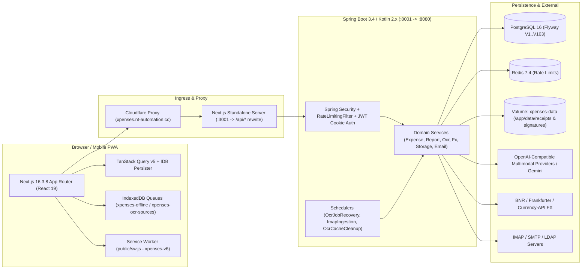

# Xpenses — Full-Stack Application Audit & Product Improvement Analysis

**Audit Date:** 2026-10-17  
**Repository:** `AdelinPOA/xpenses-kotlin` (`HEAD` @ `37e01a1`)  
**Production Environment:** `https://xpenses.nt-automation.cc` (Host `hst-dbn`)  
**Audit Scope:** Full-Stack Read-Only Analysis (Frontend, UI/UX, Mobile-First, Desktop, Accessibility, PWA, Product Discovery, Backend, Database, Security, Performance, Infrastructure)

---

## A. Executive Summary

### 1. Overall Assessment

**Xpenses** is an ambitious, domain-rich field-service expense management platform built on a modern, well-chosen stack (**Next.js 16.3.8 + React 19 + Tailwind CSS v4 + TanStack Query v5** on the frontend; **Kotlin 2.x + Spring Boot 3.4 + PostgreSQL 16 + Flyway (103 migrations) + Redis 7.4** on the backend).

Recent engineering iterations have delivered impressive architectural capabilities that many competing internal tools lack:
- **Durable 3-stage OCR job processing (`ADR-0004`, `V103`)** with database lease-fencing (`OcrJob`, `OcrJobRecoveryScheduler`) and local IndexedDB staging (`ocrSourceQueue.ts`, `offlineQueue.ts`).
- **GUI-managed AI Provider & Model Chains (`ADR-0006`, `/admin/ocr`)** with SSRF-hardened DNS pinning (`PinnedDnsResolver`), write-only AES-256-GCM API key encryption, synthetic receipt verification before model activation, and ordered fallback chains for both receipt OCR and delegation-email parsing.
- **Durable IMAP delegation email ingestion (`ADR-0003`, `V99`/`V102`)** with PostgreSQL claim ledgers and order-number deduplication.
- **BNR FX rate integration (`ADR-0001`)** with per-currency bank markup margins (`fx_margins`) and debited-amount ground-truth rate derivation.
- **Bilingual i18n parity (`en` / `ro`)** verified across 1,028 translation keys (`npm run i18n:check`).

However, when evaluated holistically as a **live production application and mobile-first field tool**, Xpenses currently suffers from **severe production security exposures, a data-destroying administrative action, cross-user client cache leaks, fragmented mobile capture workflows, and systematic SSR/database performance inefficiencies**:

1. **Critical Production Security & Data-Loss Defects (P0):**
   - **Live Admin Demo Accounts Enabled in Production (`SEC-01`):** `SEED_DEMO_USERS=true` is active in production, leaving `mod1/mod1` (full administrator) and `cfo1/cfo1` (finance officer) live alongside 21 real employees.
   - **Rate-Limiting Completely Bypassed via `X-Forwarded-For` (`SEC-02`):** `server.forward-headers-strategy: framework` in `application.yml:88-89` causes Spring's `ForwardedHeaderFilter` to overwrite `request.remoteAddr` before `RateLimitingFilter` executes, defeating `trustedProxies` validation. Furthermore, `/api/reports/{id}/export` and `/api/expenses/bulk-upload` are omitted from `RateLimitingFilter` path patterns (`SEC-04`).
   - **Orphan Receipt Cleanup Deletes All Insurance Documents and Active OCR Source Files (`BE-01`):** `AppSettingsService.findOrphanReceiptFiles()` (`AppSettingsService.kt:273-283`) scans `/app/data/receipts` and deletes any file not in `receiptRepository.findAllFilePaths()`—which wipes every user's uploaded travel insurance PDFs (`{userId}/insurance/*`), active async OCR staging files (`ocr-sources/*`), and soft-deleted audit receipts!
   - **Cross-User Financial Data Leak in IndexedDB & Service Worker Cache (`PWA-01`, `PWA-02`):** `queryPersister.ts` stores React Query state (`expenses`, `reports`, `dashboard`) under a global unscoped key `"persisted_state"` and is never cleared on `401` session expiry or `login()`. Simultaneously, `public/sw.js` (`networkFirstNavigation`) caches authenticated Next.js SSR HTML responses containing dehydrated user data under `/offline-shell`.

2. **Mobile UX & Workflow Friction (Primary Priority):**
   - **Three Competing Entry Points for "Add Expense" (`UX-01`):** Tapping `New` on the mobile Dashboard goes to `/expenses/capture` (continuous batch capture), tapping the floating action button (FAB) or `Add expense` on `/expenses` goes to `/expenses/new` (a long manual form with a second embedded scanner), and the `More` menu on `/expenses` opens `BulkUploadZone` / `BulkReviewDrawer` (a third synchronous bulk flow).
   - **Batch Capture (`ADR-0004`) vs. Immediate Review (`docs/ux/mobile-ios-review`):** Field testing and product review established that technicians capturing a single receipt expect **Immediate Verification** (confirming extracted amount, currency, and merchant right after capture) with a secondary *"Confirm & Scan Next"* action, rather than staying on the camera screen while drafts silently land in the background.
   - **Unusable Mobile Bulk Review Drawer (`MOB-01`, `UX-02`):** At `375px–390px` viewports, `BulkReviewDrawer.tsx:261-306` squeezes a 56px thumbnail, a 2-column input grid, and a 44px delete button into a single row—leaving the Amount input only **18–20px wide** (illegible) and swallowing HTTP 500 upload errors as a green checkmark (`"No expenses created"`).
   - **Orphaned Offline Captures (`PWA-03`):** Receipts captured offline on `/expenses/capture` are stored uncompressed in `xpenses-ocr-sources` (`ocrSourceQueue.ts`), which is **not connected to `OfflineSyncProvider.tsx`**. If the technician navigates away from `/expenses/capture`, those receipts never sync when connectivity returns.

3. **Frontend & Backend Performance / Correctness Gaps:**
   - **100% SSR Prefetch Cache Misses on Core Pages (`FE-01`):** `dashboard/page.tsx`, `expenses/page.tsx`, and `reports/page.tsx` prefetch data on the server under React Query keys that **do not match** the keys queried by `DashboardClient.tsx`, `ExpensesClient.tsx`, and `ReportsClient.tsx`, causing every page load to fetch data twice (once on SSR, once on client mount).
   - **UTC Date Off-by-One & `en-EU` Locale Bugs (`FE-02`, `FE-03`):** Using `new Date().toISOString().slice(0, 10)` for local dates shifts dates back by 1 day between `00:00` and `02:59` EEST (`UTC+3`) and shifts `"this_month"` / `"last_month"` export boundaries (`2026-09-30` instead of `2026-10-01`). Meanwhile, `i18n/config.ts:5` maps `en` to invalid BCP-47 locale `"en-EU"`, causing `Intl.DateTimeFormat` to fall back to US `MM/DD/YYYY` dates.
   - **DB Connections Held Across External HTTP Calls & N+1 Queries (`BE-02`, `BE-03`):** While `OcrService` was fixed, `@Transactional` is still active during external FX, LDAP, and legacy email-AI HTTP requests (`ExpenseService`, `AdvanceController`, `MileageController`, `LdapService`, `EmailImportService`), and missing `receipts` batch-fetching causes `N+1` queries on every expense and report list load.

---

### 2. Direct Answers to the 10 Audit Objectives

1. **What is currently wrong with the application?**
   - **Security/Data Loss:** Live demo admin accounts (`mod1/mod1`) in production; `X-Forwarded-For` rate-limit bypass; orphan receipt cleaner deleting insurance and OCR source files; unscoped IndexedDB/SW caches leaking data across sessions;broken `scripts/backup-db.sh` volume name (`xpenses_xpenses-data` instead of `xpenses-kotlin_xpenses-data`).
   - **UX/Bugs:** Silent bulk upload failures; stuck drag-and-drop overlay; UTC date off-by-one errors in Romania (`UTC+3`); manual FX rate leaking into EUR expenses; Dashboard "Approved" card displaying `paid` totals; `/search` page dropping `users`, `insurance`, and `advances` results; `insurance.subtitle` raw translation key shown in UI; 80+ hardcoded English strings in Admin pages.
2. **What is missing?**
   - Unified capture-to-verify flow; client-generated idempotency keys (`Idempotency-Key`) for offline expense creation; multi-receipt support in Expense Detail view; OCR field-level confidence highlights; duplicate receipt warning for technicians; scheduled cleanup for `ocr-sources/` files and expired `refresh_tokens`; keyboard shortcuts and side-by-side desktop split view in `ExpenseForm`.
3. **What would improve the mobile PWA experience the most?**
   - (a) Wiring `ocrSourceQueue.ts` into `OfflineSyncProvider.tsx` and compressing camera photos before IndexedDB storage; (b) unifying the mobile `+` / `Capture` entry points into a single **Capture → Immediate Verify → Confirm / Scan Next** workflow; (c) fixing the `BulkReviewDrawer` mobile card layout so Amount/Currency/Date are full-width and readable at `320px–390px`; (d) fixing the `AppShell.tsx` bottom nav active-tab collision (`/expenses` and `/expenses/capture` both active simultaneously) and top `ConnectionBanner` overlap on notched iPhones.
4. **What would improve the desktop web experience?**
   - Making `ExpenseForm` use a true 2-column split screen (`max-w-6xl`) with sticky zoomable receipt preview alongside form inputs (already partially scaffolded in `ExpenseForm.tsx:557`, but constrained by narrow parent wrappers in `expenses/new/page.tsx:16` and `expenses/[id]/edit/page.tsx:50` which wrap `<ExpenseForm>` in `max-w-lg`!); making desktop table rows clickable in `ExpensesClient.tsx`; adding keyboard shortcuts (`Cmd+K` search, `N` new expense, `J/K` or arrows in review drawers).
5. **Which existing screens should be redesigned?**
   - `BulkReviewDrawer.tsx` (mobile layout + error states), `expenses/new/page.tsx` & `expenses/[id]/edit/page.tsx` (remove `max-w-lg` wrapper that breaks desktop 2-column split and streamline mobile top scanner), `expenses/[id]/page.tsx` (support all attached receipts, not just `receipts[0]`), `reports/[id]/ReportDetailClient.tsx` (prioritize status/reimbursement summary and collapse 9 header buttons on mobile), and `app/search/page.tsx` (render all 5 entity types returned by `/api/search`).
6. **What frontend code should be cleaned up or refactored?**
   - Fix the 4 SSR `HydrationBoundary` query-key mismatches; centralize query keys in `lib/queryKeys.ts`; extract a shared accessible `<Modal>` / `<Drawer>` primitive with focus trapping and Escape handling; remove 601 lines of dead dashboard components (`ManagerKpiCards.tsx`, `SlideOverReviewDrawer.tsx`); replace `new Date().toISOString().slice(0, 10)` with a local-timezone date helper; deduplicate proactive/reactive token refresh in `lib/auth.ts` and `lib/api.ts`.
7. **What backend weaknesses should be addressed?**
   - Fix `AppSettingsService.findOrphanReceiptFiles()`; remove `server.forward-headers-strategy: framework`; move `fxService.getRate()` and `ldapService` network calls outside `@Transactional`; add `hibernate.default_batch_fetch_size: 50` and set `open-in-view: false`; map `MaxUploadSizeExceededException` (413) and `OptimisticLockException` (409) in `ValidationExceptionHandler.kt`; replace `canViewAll` with `canManage` in `AdvanceController.kt`; fix `ExpenseReportLifecycle.recall()` metadata cleanup and block editing expenses attached to `"rejected"` reports until recalled.
8. **What features would make the application more useful and efficient?**
   - Duplicate receipt detection (by SHA-256 hash or `{merchant, date, amount}` tuple); OCR low-confidence field highlighting; one-tap *"Attach to active Draft Report"* during expense creation; batch category/report assignment in `/expenses`; automated email/push digest for stale drafts and pending approvals.
9. **Which improvements offer the greatest value for the least effort?**
   - Removing `max-w-lg` in `expenses/new/page.tsx` and `expenses/[id]/edit/page.tsx` (2-line change that immediately unlocks the desktop 2-column side-by-side receipt preview!); fixing the 4 SSR query keys (15-minute fix eliminating double network fetches on every page load); adding `default_batch_fetch_size: 50` in `application.yml` (1-line change eliminating N+1 receipt queries); fixing `BulkReviewDrawer` mobile grid and `onError` handler (~1 hour).
10. **What is the best practical development roadmap?**
    - A 5-phase sequence detailed in **Section K**: **Phase 1** (P0 security, data-loss prevention, cache isolation, and broken backup fixes) → **Phase 2** (Mobile UI/UX, Bulk Review Drawer, desktop split-view, and accessibility modal primitives) → **Phase 3** (Unified Capture-to-Verify workflow, multi-receipt view, full search page, and domain lifecycle fixes) → **Phase 4** (SSR cache alignment, backend transaction boundaries, N+1 batching, and unified offline queue with idempotency) → **Phase 5** (Smart duplicate detection, OCR confidence badges, and keyboard power-user workflows).

---

## B. Application Architecture Summary

### 1. Technology Stack & Infrastructure Topology



### 2. User Roles & Access Permissions Matrix

| Role (`users.role`) | UI Label | Scope & Capabilities |
|---|---|---|
| `technician` | Technician | Capture receipts, create/edit own draft expenses, group into `ExpenseReport`, request cash advances, log mileage, upload digital signature, export own reports, manage own insurance files. |
| `manager` | Manager | All `technician` capabilities + view all team expenses/reports/advances/insurance, approve or reject `submitted` reports (`/approvals` and `/dashboard`), pay or reject cash advances. |
| `chef_finance` | Chef Finance | All `manager` capabilities + toggle Personal vs. Org-Wide Dashboard view, mark `approved` reports as `paid` (`/payments`), manage categories (`/categories`), view all financial exports. |
| `mod` | Moderator / Admin | Full administrative control over `/admin/*` (`users`, `settings`, `ocr`, `imap`, `email`, `ldap`, `storage`, `receipts`), plus read-all visibility (`canViewAll`). *(Note: Due to bug `BE-05`, `mod` can also currently mutate/pay advances in `AdvanceController.kt`.)* |

### 3. Frontend Route → Backend API → Database Mapping

| Frontend Route | Primary Components | Backend Endpoints | Primary Database Tables |
|---|---|---|---|
| `/login` | `app/login/page.tsx` | `POST /api/auth/login`, `POST /api/auth/refresh`, `GET /api/auth/me` | `users`, `refresh_tokens` |
| `/dashboard` | `DashboardClient.tsx`, `PendingReportsTable.tsx`, `SpendChart.tsx` | `GET /api/dashboard`, `GET /api/dashboard/manager`, `GET /api/reports`, `GET /api/advances/pending`, `GET /api/settings/ui` | `expenses`, `expense_reports`, `advance_payments`, `app_settings` |
| `/expenses` | `ExpensesClient.tsx`, `BulkUploadZone.tsx`, `BulkReviewDrawer.tsx`, `OfflineQueuePanel.tsx` | `GET /api/expenses`, `DELETE /api/expenses/{id}`, `POST /api/expenses/{id}/duplicate`, `POST /api/expenses/bulk-upload`, `GET /api/expenses/export` | `expenses`, `receipts`, `categories`, `ocr_result_cache`, `ocr_comparisons` |
| `/expenses/capture` | `app/expenses/capture/page.tsx` | `POST /api/ocr/jobs`, `GET /api/ocr/jobs/{id}`, `DELETE /api/ocr/jobs/{id}` | `ocr_jobs`, `expenses`, `receipts` + client IndexedDB `xpenses-ocr-sources` |
| `/expenses/new`, `/expenses/[id]/edit` | `ExpenseForm.tsx`, `ReceiptScanner.tsx`, `FxRateInput.tsx`, `ReceiptPreview.tsx` | `POST /api/expenses`, `PATCH /api/expenses/{id}`, `POST /api/expenses/{id}/receipts`, `POST /api/ocr/jobs`, `GET /api/fx/rate` | `expenses`, `receipts`, `fx_rates`, `categories`, `ocr_jobs` + client IDB `xpenses-offline` |
| `/expenses/[id]` | `app/expenses/[id]/page.tsx` | `GET /api/expenses/{id}`, `GET /api/expenses/{id}/receipts/{rid}` | `expenses`, `receipts` |
| `/reports`, `/reports/new`, `/reports/[id]` | `ReportsClient.tsx`, `ReportDetailClient.tsx`, `ReportReceiptsDrawer.tsx` | `GET /api/reports`, `POST /api/reports`, `GET /api/reports/{id}`, `POST /api/reports/{id}/status`, `GET /api/reports/{id}/export` | `expense_reports`, `expenses`, `advance_payments`, `mileage_records` |
| `/reports/[id]/mileage` | `app/reports/[id]/mileage/page.tsx` | `GET/POST/PUT/DELETE /api/reports/{id}/mileage`, `GET /api/settings/mileage` | `mileage_records`, `app_settings`, `fx_rates` |
| `/approvals` | `app/approvals/page.tsx` | `GET /api/reports/review-queue`, `POST /api/reports/{id}/status`, `POST /api/reports/bulk-status` | `expense_reports`, `expenses` |
| `/payments` | `app/payments/page.tsx` | `GET /api/reports?status=approved&all=true`, `POST /api/reports/{id}/status` | `expense_reports` |
| `/advances` | `app/advances/page.tsx` | `GET/POST /api/reports/{id}/advances`, `PUT/DELETE /api/advances/{id}`, `POST /api/advances/{id}/pay`, `POST /api/advances/{id}/reject` | `advance_payments`, `expense_reports`, `fx_rates` |
| `/insurance` | `app/insurance/page.tsx` | `GET/POST /api/insurance`, `GET/DELETE /api/insurance/{id}` | `insurance_files` |
| `/categories` | `app/categories/page.tsx` | `GET/POST /api/categories`, `PUT/DELETE /api/categories/{id}` | `categories` |
| `/profile`, `/profile/[id]` | `app/profile/page.tsx`, `SignatureManager.tsx`, `ProfileDetailClient.tsx` | `PUT /api/users/me`, `POST /api/auth/change-password`, `GET/POST/DELETE /api/users/me/signature`, `GET /api/users/{id}/overview` | `users`, `refresh_tokens` |
| `/search` | `app/search/page.tsx`, `SearchDropdown.tsx` | `GET /api/search?q=...` | `expense_reports`, `expenses`, `users`, `insurance_files`, `advance_payments` |
| `/admin/*` | `UsersClient.tsx`, `SettingsClient.tsx`, `OcrModelSettings.tsx`, `admin/imap`, `admin/email`, `admin/ldap`, `admin/storage`, `admin/receipts` | `/api/users/**`, `/api/settings/**`, `/api/ocr/**`, `/api/fx/**`, `/api/delegation/**` | `users`, `app_settings`, `fx_rates`, `ocr_comparisons`, `imap_processed_messages`, `storage_migration_files` |

### 4. Automated Checks & Verification Executed During This Audit

All checks were executed safely and non-destructively in compliance with `AGENTS.md`:
- `cd frontend && npm run typecheck`: **PASSED** (`tsc --noEmit` — 0 errors).
- `cd frontend && npm run i18n:check`: **PASSED** (`1028 keys present in both locales`).
- `cd frontend && npm run lint`: **PASSED** (0 errors).
- `docker compose ps` & `curl -s http://localhost:8001/api/health`: **HEALTHY** (`{"status":"ok"}`).

---

## C. Quality Scorecard

| Area | Score | Evidence-Based Justification |
|---|---:|---|
| **Mobile UI** | **6.2 / 10** | Strong foundation (bottom nav with 56–64px targets, safe-area utilities in `globals.css`, card views on `/expenses` and `/reports`, haptic feedback). Penalized by broken `BulkReviewDrawer` at `375px` (18px-wide amount input), `ConnectionBanner` overlapping fixed `#app-header` without `pt-safe`, dual active tabs on `/expenses/capture`, crowded 9-button header on `/reports/[id]`, and `<16px` inputs in `BulkReviewDrawer` (`text-xs` on lines 253–315 previously, partially updated, still `text-xs` in `ReportDetailClient.tsx:311` and `admin/imap/page.tsx:698`). |
| **Desktop UI** | **6.5 / 10** | Clean dashboard charts, collapsible sidebar, and drag-and-drop overlay on `/expenses`. Penalized because `expenses/new/page.tsx:16` and `expenses/[id]/edit/page.tsx:50` wrap `<ExpenseForm>` in `max-w-lg`, crippling the `max-w-6xl` 2-column side-by-side receipt split layout; non-clickable desktop table rows in `ExpensesClient.tsx:623`; and zero keyboard shortcuts. |
| **UX and Usability** | **6.4 / 10** | Good inline 2-step delete confirmation (`ExpensesClient.tsx:246`), unsaved-changes guard on `ExpenseForm`, and BNR FX margin/debited-amount calculator (`FxRateInput.tsx`). Penalized by 3 competing "Add Expense" flows, batch capture not opening immediate review, silent failure in `BulkReviewDrawer`, Dashboard "Approved" card showing `paid` totals (`DashboardClient.tsx:714-727`), `/search` page ignoring 3 of 5 entity types, and `ExpenseForm` / `expenses/[id]` ignoring multiple receipts beyond `receipts[0]`. |
| **Visual Consistency** | **7.0 / 10** | Cohesive slate + burnt-orange (`#c2410c`) palette, tabular numerals on amounts, and well-structured dark mode tokens. Penalized by Recharts white tooltip in dark mode (`SpendChart.tsx:76,134`), hardcoded light colors in `global-error.tsx:16`, mixed `window.confirm()` vs custom modals, and 80+ untranslated English strings across Admin/Mileage/Error views when using Romanian (`ro`). |
| **PWA Maturity** | **6.0 / 10** | Has installable `manifest.json` (with `id`, `scope`, maskable icons), offline app-shell fallback (`sw.js`), and leased IndexedDB queues (`offlineQueue.ts`, `ocrSourceQueue.ts`). Penalized by **critical cross-user data leaks** in `queryPersister.ts` and `sw.js`, `ocrSourceQueue` not connected to `OfflineSyncProvider` (offline camera captures never sync outside `/expenses/capture`), uncompressed raw camera blobs in `ocrSourceQueue`, and non-actionable SW update toast (`PwaRegistration.tsx:23`). |
| **Accessibility** | **5.8 / 10** | Good semantic form labels in `ExpenseForm`, `aria-current="page"` on nav, and `prefers-reduced-motion` support (`globals.css:79`). Penalized because **zero modals/drawers implement focus trapping**, clickable `<tr>`/`<div>` rows in `ReportsClient.tsx:238,394` lack `tabIndex`/`onKeyDown`, `ToastProvider.tsx:91` lacks `aria-live`, `text-slate-400` fails WCAG AA contrast (2.53:1), and micro-text (`text-[8px]`–`text-[10px]`) is used in admin views. |
| **Frontend Architecture** | **6.5 / 10** | Modern Next.js 16 + TanStack Query + `next-intl` setup with clean separation of `expenseSaving.ts` transport/store seams. Penalized by 100% SSR prefetch cache misses on 4 of 7 SSR pages (`dashboard`, `expenses`, `reports`, `admin/settings`), UTC `toISOString()` date bugs, invalid `en-EU` locale, and uncoordinated token refresh between `AuthProvider.tsx` and `api.ts`. |
| **Backend Architecture** | **7.2 / 10** | Well-structured modular monolith with 103 Flyway migrations, durable leased `OcrJob` pipeline, SSRF-safe `OpenAiCompatibleClient`, and transactional receipt staging in `ExpenseService`. Penalized by catastrophic orphan receipt cleaner bug (`AppSettingsService.kt:273`), external HTTP calls inside `@Transactional`, unmapped Spring exceptions returning HTTP 500 (`ValidationExceptionHandler.kt`), and report/advance state machine edge cases. |
| **Security** | **3.5 / 10** | Strong cryptographic primitives (AES-256-GCM, SHA-256 refresh token hashing, `tokenVersion` revocation, DNS-pinned SSRF guard, magic-byte receipt checks). Severely penalized in production by **`SEED_DEMO_USERS=true` (`mod1/mod1` live admin access)**, **`server.forward-headers-strategy: framework` `X-Forwarded-For` rate-limit bypass**, cross-user client cache leaks, `mod` privilege escalation on advances, and missing magic-byte check on insurance uploads. |
| **Performance** | **6.5 / 10** | Dashboard SQL aggregates (`V98`/repository sums) and async OCR jobs improved tail latency. Penalized by SSR double-fetches, N+1 queries on `expense.receipts` and `report.expenses`, DB connection pool (`size=10`) held during external FX/LDAP HTTP calls, and unbounded in-memory PDF merging (`PdfService.kt:52`). |
| **Maintainability** | **7.4 / 10** | Excellent domain documentation (`CONTEXT.md`, `README.md`, 6 ADRs), strict i18n parity script, and 45 backend test classes + Playwright suite. Penalized by 600+ lines of dead frontend code, duplicatedlegacy `EmailImportService` alongside `TechnicianEmailIngestionService`, and drift between `RateLimitingFilter` regexes and controller routes. |
| **Production Readiness** | **4.0 / 10** | Containers are healthy and monitored, but live default admin credentials (`mod1/mod1`), broken `scripts/backup-db.sh` volume name leaving 112 MB of receipts unbacked-up, unbounded `/app/data/receipts/ocr-sources/` disk growth, and co-resident dev tooling on a memory-constrained host prevent a passing production grade until Phase 1 items are remediated. |

---

## D. Complete UI/UX, Mobile-First, Desktop, Accessibility & PWA Findings

> **Note on Classification:** Findings below clearly separate **Confirmed Defects** (verified in source code and/or browser runtime) from **UX & Design Observations** (structural workflow and layout critiques).

### D.1 Mobile-First & Core Technician Workflow Findings

#### `UX-01` — Three Competing, Inconsistent Entry Points for "Add Expense" & Missing Immediate Post-Capture Verification
- **Type:** UX Observation / Confirmed Product-Workflow Mismatch
- **Category:** User Experience / Mobile
- **Priority:** **P0 — Critical**
- **Affected Screens / Components:** Mobile Dashboard (`DashboardClient.tsx`), Bottom Navigation (`AppShell.tsx`), Expenses List (`ExpensesClient.tsx`), Capture Page (`app/expenses/capture/page.tsx`), New Expense Page (`app/expenses/new/page.tsx`)
- **Source References:**
  - `frontend/app/dashboard/DashboardClient.tsx:656-667` (`New` pill links to `/expenses/capture`)
  - `frontend/app/dashboard/DashboardClient.tsx:789-806` (Quick-add FAB links to `/expenses/new` with a `Camera` icon!)
  - `frontend/components/layout/AppShell.tsx:51` (Elevated center bottom-nav button links to `/expenses/capture`)
  - `frontend/app/expenses/ExpensesClient.tsx:398-407` (`Add expense` button links to `/expenses/new`)
  - `frontend/app/expenses/capture/page.tsx:191-225` (Background scan stays on `/expenses/capture` and only shows a toast + small feed row)
- **Current Behavior:**
  1. Tapping the primary `+ New` pill on the Mobile Dashboard (`DashboardClient.tsx:657`) or the center Camera button in the bottom bar (`AppShell.tsx:51`) opens `/expenses/capture`.
  2. Tapping the optional Floating Action Button on the Dashboard (`DashboardClient.tsx:792`, which also displays a `Camera` icon) or `+ Add expense` on `/expenses` (`ExpensesClient.tsx:399`) opens `/expenses/new`—a long manual form with its own `ReceiptScanner` dropzone at the top (`ExpenseForm.tsx:591-606`).
  3. Tapping the `...` menu on `/expenses` (`ExpensesClient.tsx:343`) opens a third flow (`BulkUploadZone` → `BulkReviewDrawer`).
  4. When a technician takes a photo in `/expenses/capture`, the page stays on the camera launcher while OCR runs asynchronously (`capture/page.tsx:191-225`), never opening the extracted data for verification unless the technician manually taps `Details →` (`line 607`) on the session list item.
- **Problem / Missing Capability:** Technicians do not know which button to tap for their intent, and when capturing a single receipt (the 90% field case), staying on an empty camera launcher while OCR completes silently in a list below creates anxiety about whether the amount, currency, or merchant was misread.
- **User Impact:** High cognitive load for non-technical field technicians; unverified OCR drafts accumulate in `/expenses` with missing categories or misread amounts.
- **Concrete Redesign:**
  1. **Unify Entry Intent:** Every "Add Expense" trigger on mobile provides a clear, predictable path:
     - The center bottom-nav `Capture` button (`AppShell.tsx:51`) and Dashboard `+ New` (`DashboardClient.tsx:657`) open the unified capture-first flow.
     - Remove the redundant Dashboard floating FAB (`DashboardClient.tsx:789-806`) or point it to the same flow so two camera buttons are never visible on the same screen.
  2. **Immediate Verification After Single Capture (Aligned with `docs/ux/mobile-ios-review`):**
     - When a single photo/file finishes OCR extraction on `/expenses/capture` (or if OCR fails and creates a photo-only draft), transition automatically into the **Immediate Verification Drawer / Screen** for that draft (`amount` + `currency` prominent at the top, compact receipt thumbnail that taps to fullscreen `ReceiptLightbox`, `merchant`, `date`, `category`, and collapsed `Additional details`).
     - Provide two explicit actions at the bottom:
       - **Primary CTA:** `Confirm Expense` (marks the draft as verified and navigates to `/expenses?highlight={id}`).
       - **Secondary CTA:** `Confirm & Scan Next` (confirms current expense and immediately re-triggers the camera input for serial capture).
- **Expected Benefit:** Eliminates duplicate/confusing entry points and guarantees every scanned receipt is verified by the technician without sacrificing durable background OCR staging (`ADR-0004`).
- **Implementation Difficulty:** Medium | **Effort:** ~8–12 dev-hours | **Dependencies:** `PWA-03`
- **Confidence Level:** High (Verified in code and `docs/ux/mobile-ios-review/README.md`)

---

#### `MOB-01` — `BulkReviewDrawer` Layout Crushes Amount Input to 18–20px on Mobile Screens (`320px–390px`) & Swallows Errors
- **Type:** Confirmed Defect
- **Category:** Mobile / UI / User Experience
- **Priority:** **P0 — Critical**
- **Affected Component:** `BulkReviewDrawer`
- **Source References:**
  - `frontend/components/expenses/BulkReviewDrawer.tsx:41-47` (`useMutation` missing `onError`)
  - `frontend/components/expenses/BulkReviewDrawer.tsx:72-76, 88-92` (`patchField` and `deleteRow` `catch` blocks silently swallow errors)
  - `frontend/components/expenses/BulkReviewDrawer.tsx:196-201` (Renders green `CheckCircle` + `No expenses created` when HTTP 500 occurs)
  - `frontend/components/expenses/BulkReviewDrawer.tsx:235` (`expense.receipts[0]` unguarded crash risk if `receipts` is undefined/empty)
  - `frontend/components/expenses/BulkReviewDrawer.tsx:246-345` (Horizontal flex row containing `w-14` thumbnail + `grid-cols-2` inputs + `min-w-11` delete button inside `px-6` + `p-4` padding)
  - `frontend/components/expenses/BulkReviewDrawer.tsx:284` (`parseFloat(e.target.value) || 0` overwrites cleared amount with `0`)
- **Current Behavior:**
  1. On a `375px` screen, `BulkReviewDrawer` applies `px-6` (`48px`) on the body (`line 148`) and `p-4` (`32px`) on each card (`line 239`), leaving `295px`. Inside that row (`line 246`), the `56px` thumbnail (`w-14`), `44px` delete button (`min-w-11`), and `24px` gaps leave only `171px` for a 2-column grid (`grid-cols-2`, `81px` per column). Inside Column 1 (`line 277`), the Amount `<input>` shares its `81px` column with a `64px` (`w-16`) Currency input (`line 292`) and a `4px` gap—leaving the **Amount input only `13px–20px` wide**! The digits of the expense amount are completely hidden.
  2. If `POST /api/expenses/bulk-upload` fails (e.g., HTTP 500 or 413), `rows` and `uploadErrors` remain empty (`lines 41-47`), so lines `196-201` render a green `CheckCircle` icon and `"No expenses created"`, misleading the user into thinking everything succeeded.
  3. If `api.patch` or `api.delete` fails (`lines 72, 88`), the error is silently ignored, leaving the user's edited `defaultValue` visible in the DOM even though the server rejected the save!
- **User Impact:** Bulk review is completely unusable on smartphones (`320px–430px`), and network/server errors result in silent data loss or false success screens.
- **Concrete Redesign:**
  1. **Mobile-First Card Structure (`BulkExpenseRow`):**
     - Move the `56x56px` receipt thumbnail, merchant input, and `44x44px` Delete button into a **top header row** of the card.
     - Place the remaining fields below in a **full-width responsive grid**:
       - Row 2: `Amount` (`flex-1 min-w-[120px]`) + `Currency` `<select>` (`w-24`, using `CURRENCIES` dropdown instead of a free-text `<input>`!)
       - Row 3: `Date` (`col-span-2 sm:col-span-1`) + `Category` (`col-span-2 sm:col-span-1`)
       - Row 4: Collapsible or single-line `Description`.
     - Reduce body horizontal padding on mobile from `px-6` to `px-3 sm:px-6` (`line 148`).
  2. **Explicit Error & Save Feedback:**
     - Add `uploadError: string | null` state populated by `onError` on `useMutation` (`line 41`), rendering a red `role="alert"` banner with a **Retry Upload** button instead of the green `CheckCircle`.
     - Guard `expense.receipts?.[0]` (`line 235`).
     - Validate `const parsed = parseFloat(e.target.value); if (!Number.isFinite(parsed) || parsed <= 0) return;` before calling `onPatch("amount", parsed)` (`line 284`).
     - Show per-row inline error message or toast if `patchField` or `deleteRow` fails (`lines 72, 88`).
- **Expected Benefit:** Makes bulk receipt review effortless on `320px–430px` phones and prevents silent data corruption.
- **Implementation Difficulty:** Low–Medium | **Effort:** ~4 dev-hours | **Dependencies:** None
- **Confidence Level:** Confirmed (Verified in `BulkReviewDrawer.tsx` and browser screenshot `docs/ux/mobile-ios-review/bulk-375.png`)

---

#### `MOB-02` — Bottom Navigation Highlights Two Tabs Simultaneously on `/expenses/capture` & Top `ConnectionBanner` Collides with iOS Safe Area and `#app-header`
- **Type:** Confirmed Defect
- **Category:** Mobile / Navigation / PWA
- **Priority:** **P1 — High**
- **Affected Components:** `AppShell.tsx`, `OfflineSyncProvider.tsx`
- **Source References:**
  - `frontend/components/layout/AppShell.tsx:49-54, 141` (`const active = pathname === href || (href !== "/dashboard" && pathname.startsWith(href));`)
  - `frontend/components/OfflineSyncProvider.tsx:180-193` (`<div role="status" className="fixed top-0 left-0 right-0 z-[60] bg-amber-500 ...">`)
  - `frontend/components/layout/AppShell.tsx:58, 84-109` (`<header id="app-header" className="lg:hidden fixed top-0 left-0 right-0 z-30 ... pt-safe">`)
- **Current Behavior:**
  1. In `AppShell.tsx:141`, because `"/expenses/capture".startsWith("/expenses")` is `true`, navigating to `/expenses/capture` sets `active = true` and `aria-current="page"` on **both** the `Expenses` tab (`href="/expenses"`) and the `Capture` tab (`href="/expenses/capture"`).
  2. When offline or syncing, `ConnectionBanner` (`OfflineSyncProvider.tsx:181-193`) renders at `fixed top-0 left-0 right-0 z-[60]` **without `pt-safe`**. On iPhones in standalone PWA mode (`viewportFit: "cover"`), it renders underneath the iPhone Dynamic Island / notch and directly covers the top of `#app-header` (or the desktop header/sidebar). Meanwhile, `#app-header` (`AppShell.tsx:84-109`) already renders a cleaner offline/sync pill inside the safe-area header!
- **User Impact:** Broken navigation state (screen readers announce two current pages; visual confusion) and overlapping/clipped top banners on iOS devices when offline.
- **Concrete Redesign:**
  1. Fix active tab matching in `AppShell.tsx:141`:
     ```ts
     const active =
       pathname === href ||
       (href !== "/dashboard" &&
        pathname.startsWith(`${href}/`) &&
        !navItems.some((other) => other.href !== href && other.href.length > href.length && pathname.startsWith(other.href)));
     ```
  2. Integrate the offline/failed sync banner cleanly below `#app-header` (or inside `AppShell` above `<main>` with `pt-safe` on desktop) instead of an unaligned `fixed top-0 z-[60]` overlay in `OfflineSyncProvider.tsx:181`.
- **Expected Benefit:** Clean, native-feeling iOS/Android navigation and safe-area compliance when working offline.
- **Implementation Difficulty:** Low | **Effort:** ~1.5 dev-hours | **Dependencies:** None
- **Confidence Level:** Confirmed (Verified in `AppShell.tsx:141` and `OfflineSyncProvider.tsx:181`)

---

#### `MOB-03` — Inputs with `font-size < 16px` (`text-xs` / `text-sm`) Trigger Forced iOS Safari Viewport Auto-Zoom
- **Type:** Confirmed Defect
- **Category:** Mobile / UI
- **Priority:** **P1 — High**
- **Affected Screens / Components:** `ReportDetailClient.tsx`, `OcrModelSettings.tsx`, `SettingsClient.tsx`, `admin/imap/page.tsx`
- **Source References:**
  - `frontend/app/reports/[id]/ReportDetailClient.tsx:311` (`text-xs` on inline report description input)
  - `frontend/components/admin/OcrModelSettings.tsx:40` (`const inputClass = "... text-sm ..."` used across all provider/model inputs)
  - `frontend/app/admin/settings/SettingsClient.tsx:611, 623` (`text-sm` on `testCurrency` and `testDate` inputs)
  - `frontend/app/admin/imap/page.tsx:698` (`text-xs` on simulated email body `<textarea>`)
- **Current Behavior:** While `ExpenseForm.tsx` and `ExpensesClient.tsx` were updated to `text-base lg:text-sm` (`16px` on mobile, `14px` on desktop), the inputs listed above still render at `12px` (`text-xs`) or `14px` (`text-sm`) on mobile viewports. *(Note also that in `ExpenseForm.tsx:626, 641, 690, 709, 724`, `text-base lg:text-sm` works on portrait phones, but any component using `text-base sm:text-sm` drops to `14px` on iPhones in landscape mode `844px` width, triggering iOS Safari zoom!)*
- **User Impact:** Focusing these inputs on iOS Safari forces the browser viewport to zoom in and shift horizontally, requiring the user to manually pinch-zoom back out.
- **Concrete Redesign:** Standardize all `<input>`, `<select>`, and `<textarea>` elements across the entire app on `text-base lg:text-sm` (`16px` below `1024px`, `14px` on desktop `lg:`), ensuring both portrait and landscape mobile viewports stay at `>= 16px`.
- **Expected Benefit:** Zero unintended iOS Safari focus zoom across all forms and drawers in both portrait and landscape orientations.
- **Implementation Difficulty:** Low | **Effort:** ~1.5 dev-hours | **Dependencies:** None
- **Confidence Level:** Confirmed (Verified in source files)

---

#### `MOB-04` — Touch Targets Below 44×44 CSS Pixels on Lightbox, Modals, Reports, Categories & Admin Controls
- **Type:** Confirmed Defect
- **Category:** Mobile / Accessibility (WCAG 2.5.8 / Apple HIG)
- **Priority:** **P2 — Medium**
- **Affected Components:**
  - `frontend/components/expenses/ReceiptLightbox.tsx:89-133` (Zoom out, Zoom in, Reset, Download, Close buttons use `p-1.5` / `w-8 h-8` = `28×28px` to `32×32px`)
  - `frontend/components/ToastProvider.tsx:114-120` (Toast dismiss `X` button is `16×16px` with zero padding)
  - `frontend/app/reports/ReportsClient.tsx:287-300, 460-476` (Delete report icon button uses `p-1` with `w-4 h-4` = `24×24px`)
  - `frontend/app/categories/page.tsx:161-177, 224-239` (Edit/Delete category buttons use `p-1.5` = `28×28px`)
  - `frontend/app/admin/users/UsersClient.tsx:316, 422` (Activate/Deactivate user button uses `p-1.5` = `28×28px`)
  - `frontend/app/admin/settings/SettingsClient.tsx:551, 560` (FX Provider reorder buttons use `p-1.5` = `30×30px`)
  - `frontend/components/expenses/BulkReviewDrawer.tsx:176-178` (Dismiss error banner `X` button is `16×16px`)
- **Current Behavior:** While `ExpensesClient.tsx` and `AppShell.tsx` were upgraded to `min-w-11 min-h-11` (`44×44px`), the controls above remain `16px–32px`. Particularly critical is `ReceiptLightbox.tsx`, which is the primary mobile receipt inspection modal—its top bar also lacks `pt-safe` (`line 80`), placing `28px` buttons right against the iOS status bar.
- **User Impact:** Missed taps and accidental dismissal or wrong-row deletion on touchscreens.
- **Concrete Redesign:** Apply `min-w-11 min-h-11 inline-flex items-center justify-center` (`44×44px`) to all interactive icon buttons in `ReceiptLightbox.tsx`, `ToastProvider.tsx`, `ReportsClient.tsx`, `categories/page.tsx`, `UsersClient.tsx`, and `SettingsClient.tsx`, and add `pt-[max(0.75rem,env(safe-area-inset-top))]` to `ReceiptLightbox.tsx:80`.
- **Expected Benefit:** Full compliance with 44×44px mobile touch ergonomics across all screens.
- **Implementation Difficulty:** Low | **Effort:** ~2 dev-hours | **Dependencies:** None
- **Confidence Level:** Confirmed (Verified in source files)

---

### D.2 Desktop & Responsive Layout Findings (`1280px+`)

#### `DESK-01` — Parent Wrapper `max-w-lg` in `/expenses/new` and `/expenses/[id]/edit` Breaks the Desktop 2-Column Split-Screen Layout
- **Type:** Confirmed Defect
- **Category:** Desktop / UI / Visual Design
- **Priority:** **P1 — High**
- **Affected Screens:** New Expense (`app/expenses/new/page.tsx`), Edit Expense (`app/expenses/[id]/edit/page.tsx`), `ExpenseForm.tsx`
- **Source References:**
  - `frontend/app/expenses/new/page.tsx:16` (`<div className="max-w-lg">`)
  - `frontend/app/expenses/[id]/edit/page.tsx:50` (`<div className="max-w-lg">`)
  - `frontend/components/expenses/ExpenseForm.tsx:517, 557, 568, 924` (`max-w-6xl`, `flex-col lg:flex-row`, `flex-1 w-full max-w-lg`, `w-full lg:flex-1`)
- **Current Behavior:** `ExpenseForm.tsx` was explicitly engineered to render a side-by-side 2-column layout on desktop (`lg:flex-row gap-6 max-w-6xl` at lines `517, 557`), with the form on the left (`max-w-lg`) and `ReceiptPreview` sticky on the right (`lg:flex-1 lg:sticky lg:top-6`). **However**, both parent pages (`app/expenses/new/page.tsx:16` and `app/expenses/[id]/edit/page.tsx:50`) wrap `<ExpenseForm>` inside `<div className="max-w-lg">` (`512px`)! As a result, on a `1440px` or `1920px` desktop monitor, the entire 2-column `flex-row` is crushed into `512px` (~244px for the form and ~244px for the receipt preview!), while 70% of the desktop screen sits completely empty!
- **User Impact:** Severe visual cramping on desktop (`>= 1024px`); both the form inputs and the receipt preview are squeezed into ~240px columns.
- **Concrete Redesign:** Change `<div className="max-w-lg">` to `<div className="max-w-6xl">` in both `frontend/app/expenses/new/page.tsx:16` and `frontend/app/expenses/[id]/edit/page.tsx:50`.
- **Expected Benefit:** Immediately restores the intended full-width 2-column side-by-side desktop split view (`512px` form + `~600px` sticky zoomable receipt preview) with a 2-line change.
- **Implementation Difficulty:** Low | **Effort:** 0.25 dev-hours (10 minutes) | **Dependencies:** None
- **Confidence Level:** Confirmed (Verified in `new/page.tsx:16`, `edit/page.tsx:50`, and `ExpenseForm.tsx:517`)

---

#### `DESK-02` — Desktop Expenses Table Rows Are Not Clickable & Lack Select-All / Keyboard Ergonomics
- **Type:** UX Observation
- **Category:** Desktop / User Experience
- **Priority:** **P2 — Medium**
- **Affected Component:** `ExpensesClient.tsx`
- **Source References:**
  - `frontend/app/expenses/ExpensesClient.tsx:508` (Mobile card has `onClick={() => router.push(e.status === "draft" ? `/expenses/${e.id}/edit` : `/expenses/${e.id}`)}`)
  - `frontend/app/expenses/ExpensesClient.tsx:608-610, 623` (Desktop `<tr>` has no `onClick` handler and `<th>` has no Select-All checkbox)
- **Current Behavior:** On mobile (`line 508`), tapping anywhere on an expense card opens it. On desktop (`line 623`), clicking a table row in `/expenses` does nothing—the user must move their mouse across the entire screen to click a `16px` pencil icon in the rightmost column (or if the expense is `submitted`/`approved`/`paid`, there is **no link or button at all** to open `/expenses/${e.id}` from the desktop table!). Additionally, the desktop table header (`line 608`) has no "Select all draft expenses on page" checkbox.
- **User Impact:** Non-draft expenses (`submitted`, `approved`, `rejected`, `paid`) **cannot be opened at all on desktop** from `/expenses` (`lines 701-708` only render the Edit link when `e.status === "draft"`!), whereas mobile users can tap any card to view `/expenses/${e.id}`!
- **Concrete Redesign:**
  1. Make desktop `<tr>` rows in `ExpensesClient.tsx:623` interactive (or make the Merchant cell a `<Link href={e.status === "draft" ? `/expenses/${e.id}/edit` : `/expenses/${e.id}`}>`) so desktop users can open any expense.
  2. Add a "Select all drafts on page" `<input type="checkbox">` in the first `<th>` (`line 608`).
- **Expected Benefit:** Fixes the inability to view non-draft expense details on desktop and speeds up multi-expense report bundling.
- **Implementation Difficulty:** Low | **Effort:** ~1.5 dev-hours | **Dependencies:** None
- **Confidence Level:** Confirmed (Verified in `ExpensesClient.tsx:508` vs `623-712`)

---

### D.3 Screen-by-Screen UI/UX & Localization Defects

#### `UX-02` — Multiple Attached Receipts Are Invisible in Expense Detail View (`/expenses/[id]`)
- **Type:** Confirmed Defect
- **Category:** User Experience / UI
- **Priority:** **P1 — High**
- **Affected Screen:** Expense Detail (`frontend/app/expenses/[id]/page.tsx`)
- **Source References:** `frontend/app/expenses/[id]/page.tsx:154` (`const receipt = expense.receipts?.[0] ?? null;`)
- **Current Behavior:** The data model (`Expense.receipts: ReceiptOut[]`), `ExpenseForm.tsx:211-235`, and `ExpensesClient.tsx:551, 658` all support attaching multiple receipts to a single expense (e.g., a hotel folio + card slip). However, `app/expenses/[id]/page.tsx:154` hardcodes `const receipt = expense.receipts?.[0] ?? null;` and completely ignores `expense.receipts[1..n]`.
- **User Impact:** Managers, finance officers, and technicians viewing a submitted/approved expense at `/expenses/[id]` cannot see or download any secondary receipts attached to that expense.
- **Concrete Redesign:** Replace the single `receipt` variable in `app/expenses/[id]/page.tsx:154` with `ReceiptPreview` (or a tabbed/thumbnail selector identical to `ReceiptPreview.tsx:50-68`) so all receipts in `expense.receipts` can be previewed and downloaded.
- **Expected Benefit:** Ensures complete auditability of multi-page/multi-file expenses.
- **Implementation Difficulty:** Low | **Effort:** ~1.5 dev-hours | **Dependencies:** None
- **Confidence Level:** Confirmed (Verified in `app/expenses/[id]/page.tsx:154`)

---

#### `UX-03` — Global Search Page (`/search`) Silently Drops `Users`, `Insurance`, and `Advances` Results
- **Type:** Confirmed Defect
- **Category:** User Experience
- **Priority:** **P1 — High**
- **Affected Screen:** `frontend/app/search/page.tsx` vs `frontend/components/ui/SearchDropdown.tsx`
- **Source References:**
  - `frontend/components/ui/SearchDropdown.tsx:65-71, 89` (Counts and displays `reports`, `expenses`, `users`, `insurance`, and `advances`, with a `"See all results"` link to `/search?q=...`)
  - `frontend/app/search/page.tsx:44-46, 75-156` (`const totalResults = (data?.reports.length ?? 0) + (data?.expenses.length ?? 0);` — only renders `reports` and `expenses`)
- **Current Behavior:** When a user searches in the header `SearchDropdown` for an employee name, an insurance policy, or a cash advance, the dropdown shows matches and offers `"See all results (N)"`. Clicking that link navigates to `/search?q=...`, which only checks `data.reports` and `data.expenses`—displaying **"0 results found"** for the exact query that just showed results in the dropdown!
- **User Impact:** Broken search workflow for managers, finance, and admins looking up employees, advances, or insurance records.
- **Concrete Redesign:** Render the `users`, `advances`, and `insurance` sections in `frontend/app/search/page.tsx` matching the 5 sections already implemented in `SearchDropdown.tsx`, and include all 5 arrays in `totalResults` (`line 44`).
- **Expected Benefit:** Consistent, complete full-page search results.
- **Implementation Difficulty:** Low | **Effort:** ~2 dev-hours | **Dependencies:** None
- **Confidence Level:** Confirmed (Verified in `app/search/page.tsx:44-46`)

---

#### `UX-04` — Mobile Dashboard "Approved" Summary Card Actually Displays `Paid` Counts/Totals & Links to `?status=paid`
- **Type:** Confirmed Defect
- **Category:** User Experience / Financial Accuracy
- **Priority:** **P1 — High**
- **Affected Component:** `frontend/app/dashboard/DashboardClient.tsx`
- **Source References:**
  - `frontend/app/dashboard/DashboardClient.tsx:714-727` (`href="/reports?status=paid"`, label `{t("approved_summary_title")}`, values `{reportStatusTotals.paidCount}` and `{formatEur(reportStatusTotals.paidEur)}`)
  - `frontend/app/dashboard/DashboardClient.tsx:782-786` (`<ExpenseStatusOverview approved={data?.paid_count ?? 0} ... />`)
- **Current Behavior:** On the Mobile Technician Dashboard (`lines 714-727`), the third status summary card is labeled **"Approved"** (`t("approved_summary_title")` = `"Approved"` / `"Aprobate"`), but it displays `reportStatusTotals.paidCount` and `reportStatusTotals.paidEur` and links to `/reports?status=paid`! Similarly, `ExpenseStatusOverview` (`line 783`) passes `data?.paid_count` into the `approved` prop. Reports that are `approved` (awaiting payment) are completely omitted from the mobile summary cards.
- **User Impact:** Confuses technicians when their manager approves a report: the "Pending" count drops to `0`, yet the "Approved" card still shows `0` until Finance marks the report as `paid`!
- **Concrete Redesign:** Either label the card accurately as `t("paid_summary_title")` (`Paid` / `Plătite`) and add `Approved` to the status strip, or combine `approved + paid` with clear sub-labels so `approved` reports do not vanish into a blind spot between `submitted` and `paid`.
- **Expected Benefit:** Accurate financial status visibility for technicians tracking their reimbursement lifecycle.
- **Implementation Difficulty:** Low | **Effort:** ~1.5 dev-hours | **Dependencies:** None
- **Confidence Level:** Confirmed (Verified in `DashboardClient.tsx:714-727, 783`)

---

#### `UX-05` — Report Detail (`/reports/[id]`) Unassigned Expenses Picker Only Fetches Page 0 (`size=20`) Without `no_report=true`
- **Type:** Confirmed Defect
- **Category:** User Experience / Data Completeness
- **Priority:** **P1 — High**
- **Affected Component:** `frontend/app/reports/[id]/ReportDetailClient.tsx`
- **Source References:** `frontend/app/reports/[id]/ReportDetailClient.tsx:86-93, 206`
- **Current Behavior:** `ReportDetailClient.tsx:87-89` declares `queryKey: [...expenseKeys.all, "unassigned", { no_report: true }]`, but its `queryFn` calls `api.get("/expenses")` with **no query parameters**, and then filters `!e.expense_report_id` client-side (`line 206`). Furthermore, `Backend ExpenseController.kt:33` returns all expenses when `page` is omitted, OR if pagination is applied, `no_report` is not supported as a backend filter parameter in `ExpenseRepository.kt`.
- **User Impact:** Fetches all historical expenses (including already-reported/paid expenses) over the network just to find unassigned draft expenses, and mixes query cache semantics.
- **Concrete Redesign:** Pass `{ params: { status: "draft" } }` (or add `unattachedOnly = true` filter support in `ExpenseController` backed by the existing `ExpenseRepository.findUnattachedByUserId` method at `ExpenseRepository.kt:70`!) so only unassigned draft expenses are fetched.
- **Expected Benefit:** Faster report editing and guaranteed visibility of all unassigned draft expenses.
- **Implementation Difficulty:** Low | **Effort:** ~1.5 dev-hours | **Dependencies:** None
- **Confidence Level:** Confirmed (Verified in `ReportDetailClient.tsx:87-89` and `ExpenseRepository.kt:70`)

---

#### `UX-06` — Report Detail Header Crowds up to 9 Action Buttons on Mobile & Pushes Reimbursement Summary Below Fold
- **Type:** UX Observation
- **Category:** Mobile / User Experience
- **Priority:** **P2 — Medium**
- **Affected Component:** `frontend/app/reports/[id]/ReportDetailClient.tsx`
- **Source References:** `frontend/app/reports/[id]/ReportDetailClient.tsx:247-395`
- **Current Behavior:** Opening `/reports/[id]` on mobile renders a dense block of action buttons (`Export PDF`, `Export Excel`, `Export CSV`, `Download Receipts ZIP`, `View Receipts`, `Mileage`, `Submit` / `Recall` / `Approve` / `Reject` / `Delete`) and delegation metadata before the user sees the net reimbursement breakdown (`totalExpenses + allowance - advances`).
- **User Impact:** Technicians and managers on mobile must scroll past export utilities and metadata to see the report total, status reason (e.g., rejection reason), and primary workflow action.
- **Concrete Redesign:**
  1. Place the **Status Banner + Net Reimbursement Summary Card + Primary Workflow Action (`Submit` / `Approve` / `Reject`)** immediately below the report title.
  2. Group all export actions (`PDF`, `Excel`, `CSV`, `ZIP`) into a single `Export ▾` dropdown menu (just like `ExpensesClient.tsx:329-397`).
- **Expected Benefit:** Scannable, mobile-first report hierarchy that surfaces the next required action immediately.
- **Implementation Difficulty:** Medium | **Effort:** ~3 dev-hours | **Dependencies:** None
- **Confidence Level:** High (Verified in `ReportDetailClient.tsx` and `docs/ux/mobile-ios-review/README.md`)

---

#### `UX-07` — Missing Translation Key `"insurance.subtitle"`, Dark-Mode White Recharts Tooltip, Hardcoded Light `global-error.tsx`, and 80+ Hardcoded English Strings in Admin/Mileage Views
- **Type:** Confirmed Defect
- **Category:** UI / Visual Consistency / Localization
- **Priority:** **P2 — Medium**
- **Affected Files:**
  - `frontend/app/insurance/page.tsx:318` (`{t("subtitle")}` renders literal `"insurance.subtitle"` because key is missing from `messages/en.json` and `messages/ro.json`!)
  - `frontend/components/dashboard/SpendChart.tsx:76-82, 134-140` (`contentStyle={{ backgroundColor: "#fff", border: "1px solid #e2e8f0" }}` renders glaring white tooltip in dark mode)
  - `frontend/app/global-error.tsx:16-30`, `frontend/app/error.tsx:22-35`, `frontend/app/not-found.tsx:13-22` (Hardcoded English & hardcoded light-mode hex `#f8fafc` in `global-error.tsx`)
  - `frontend/app/reports/[id]/mileage/page.tsx:218, 224, 425, 465` (Hardcoded English strings)
  - `frontend/app/profile/page.tsx:86-93` & `frontend/app/profile/[id]/ProfileDetailClient.tsx:177-178` (Hardcoded English role names and `"active"`/`"inactive"`)
  - `frontend/app/admin/settings/SettingsClient.tsx:366-384, 421, 660-673`, `admin/users/UsersClient.tsx:103, 140, 214, 311, 417`, `admin/email/page.tsx`, `admin/imap/page.tsx`, `admin/ldap/page.tsx`, `admin/ocr/page.tsx`, `admin/receipts/page.tsx`, `admin/storage/page.tsx` (80+ hardcoded English labels, banners, and messages)
  - `frontend/components/PwaRegistration.tsx:23` (Hardcoded `"A new version is available. Refresh to update."`)
- **Current Behavior:** Although `npm run i18n:check` verifies that `en.json` and `ro.json` have identical keys, it does not check for missing keys referenced in TSX (`insurance.subtitle`) or hardcoded English literals in TSX files. Additionally, hovering/tapping `SpendChart` in dark mode displays an unstyled white box.
- **User Impact:** Romanian-locale (`ro`) users see mixed English/Romanian UI and raw translation keys (`insurance.subtitle`).
- **Concrete Redesign:**
  1. Add `"subtitle"` to `insurance` in `messages/en.json` and `messages/ro.json`.
  2. Replace `backgroundColor: "#fff"` in `SpendChart.tsx:76, 134` with CSS variables (`backgroundColor: "var(--card)", borderColor: "var(--border)", color: "var(--foreground)"`).
  3. Extract hardcoded English strings in `error.tsx`, `not-found.tsx`, `PwaRegistration.tsx`, `mileage/page.tsx`, `profile/*`, and `admin/*` into `messages/en.json` and `messages/ro.json`.
- **Expected Benefit:** Polished, 100% localized UI and seamless dark mode across charts and error screens.
- **Implementation Difficulty:** Low–Medium | **Effort:** ~4 dev-hours | **Dependencies:** None
- **Confidence Level:** Confirmed (Verified across all cited files)

---

### D.4 Accessibility (WCAG 2.2 AA) Findings

#### `A11Y-01` — Zero Modals or Drawers Implement Focus Trapping, and 3 Modals Lack `Escape` Key & Scroll Lock
- **Type:** Confirmed Defect
- **Category:** Accessibility (WCAG 2.1.2, 2.4.3, 4.1.2)
- **Priority:** **P1 — High**
- **Affected Components:**
  - `frontend/components/expenses/BulkReviewDrawer.tsx:122-127` (Has `role="dialog" aria-modal="true"`, **no focus trap**, no focus restoration)
  - `frontend/components/reports/ReportReceiptsDrawer.tsx:118-138` (No focus trap, no focus restoration)
  - `frontend/components/expenses/ReceiptLightbox.tsx:72-199` (No focus trap, no focus restoration)
  - `frontend/app/reports/ReportsClient.tsx:504-542`, `ReportDetailClient.tsx:962-1042`, `approvals/page.tsx:342-395` (No focus trap)
  - `frontend/app/payments/page.tsx:249-280`, `frontend/app/admin/receipts/page.tsx:176-202`, `frontend/app/admin/storage/page.tsx:407-448` (**Missing `role="dialog"`, `aria-modal="true"`, `Escape` key handler, `useBodyScrollLock`, AND focus trap**)
- **Current Behavior:** Only `Sidebar.tsx:88-129` implements a focus trap and `inert` background handling! Every other modal, confirmation dialog, and slide-over drawer in the application allows `Tab` focus to escape into background page elements behind the backdrop.
- **User Impact:** Keyboard and screen-reader users (VoiceOver/TalkBack) lose their place behind open dialogs and cannot close modals in `/payments`, `/admin/receipts`, or `/admin/storage` with `Escape`.
- **Concrete Redesign:** Extract the focus-trap + `Escape` + `useBodyScrollLock` + focus-restoration hook from `Sidebar.tsx:88-129` into a reusable `useModalDialog(isOpen, onClose, containerRef)` hook (or `<ModalDialog>` wrapper) and apply it to all modals and drawers.
- **Expected Benefit:** Uniform WCAG 2.2 AA dialog behavior across the entire application while eliminating duplicated overlay boilerplate.
- **Implementation Difficulty:** Medium | **Effort:** ~4 dev-hours | **Dependencies:** None
- **Confidence Level:** Confirmed (Verified in all modal/drawer components)

---

#### `A11Y-02` — Clickable Table Rows (`<tr>`) and Mobile Cards (`<div>`) Lack Keyboard Operability (`tabIndex`, `role`, `onKeyDown`), Toast Container Lacks `aria-live`, and `text-slate-400` Fails Contrast
- **Type:** Confirmed Defect
- **Category:** Accessibility (WCAG 1.4.3, 2.1.1, 4.1.3)
- **Priority:** **P2 — Medium**
- **Affected Components:**
  - `frontend/app/expenses/ExpensesClient.tsx:505-510` (`<div onClick={() => router.push(...)}>`)
  - `frontend/app/reports/ReportsClient.tsx:238-241, 394-397` (`<div onClick={...}>` and `<tr onClick={...}>`)
  - `frontend/components/ToastProvider.tsx:91` (Toast container lacks `role="status"` / `aria-live="polite"`)
  - `frontend/app/admin/settings/SettingsClient.tsx:51, 366, 384, 421`, `admin/ocr/page.tsx:29, 245, 252-270` (`text-slate-400` on light background = `2.53:1` contrast ratio; `text-[8px]`–`text-[10px]` micro-labels)
- **Current Behavior:**
  1. Navigating `/expenses` (mobile) or `/reports` (mobile & desktop) via keyboard `Tab` skips the report/expense cards and rows entirely because `<div onClick>` and `<tr onClick>` have no `tabIndex={0}` or `onKeyDown` handler, and the report title is a `<span>`/`<p>` rather than an `<a href>` / `<Link>`.
  2. Toast notifications in `ToastProvider.tsx:91` are never announced by screen readers because the container has no `aria-live` region.
  3. `text-slate-400` (`#94a3b8`) on `#ffffff` has a contrast ratio of **2.53:1** (far below the 4.5:1 WCAG AA minimum).
- **User Impact:** Keyboard users cannot open reports in `/reports` at all! Screen-reader users miss toast error/success feedback.
- **Concrete Redesign:**
  1. Make the primary title inside each card/row a semantic `<Link href={...} className="after:absolute after:inset-0 ...">` (or add `tabIndex={0}`, `role="link"`, and `Enter`/`Space` `onKeyDown` to the row).
  2. Add `role="region" aria-live="polite" aria-label="Notifications"` to the toast stack in `ToastProvider.tsx:91` (and `left-4 right-4 sm:left-auto` so toasts fit `320px` screens without overlapping the full width).
  3. Replace `text-slate-400` helper text with `text-muted` / `text-muted-foreground` (`#475569` / `#64748b` in light mode, `#94a3b8` in dark mode).
- **Expected Benefit:** Full keyboard navigability and WCAG 2.2 AA contrast & status announcement compliance.
- **Implementation Difficulty:** Low | **Effort:** ~3 dev-hours | **Dependencies:** None
- **Confidence Level:** Confirmed (Verified in source files)

---

### D.5 Progressive Web App (PWA) & Offline Architecture Findings

#### `PWA-01` — Cross-User Financial Data Leak in IndexedDB React Query Persister (`lib/queryPersister.ts` + `AuthProvider.tsx`)
- **Type:** Confirmed Defect (Security & Privacy)
- **Category:** PWA / Security / Frontend Architecture
- **Priority:** **P0 — Critical**
- **Affected Files:**
  - `frontend/lib/queryPersister.ts:8, 89-108, 119-149`
  - `frontend/components/Providers.tsx:23-26`
  - `frontend/components/AuthProvider.tsx:92-112, 142-169`
  - `frontend/app/login/page.tsx:35-39`
- **Current Behavior:**
  1. `queryPersister.ts:8` stores the dehydrated React Query cache (`categories`, `expenses`, `reports`, `settings`, `dashboard`) in IndexedDB (`xpenses-cache` → `react_query`) under a single global key `CACHE_RECORD_KEY = "persisted_state"`, **not scoped by `user.id`**.
  2. When a session expires (`401` in `AuthProvider.tsx:104-111` or `lib/api.ts:61`), `clearPersistedQueryCache()` and `queryClient.clear()` are **never called**.
  3. When a second user logs in on the same browser/device (`app/login/page.tsx:35-39`), `queryClient.clear()` and `clearPersistedQueryCache()` are **not called** either.
  4. Even when a user clicks explicit `logout()` (`AuthProvider.tsx:147`), `void clearPersistedQueryCache()` is invoked *before* `queryClient.clear()` (`line 153`) and without cancelling `saveTimer` (`queryPersister.ts:117-135`), which can fire 1000ms later and re-persist state!
- **User Impact:** On any shared tablet, field device, or desktop browser, User B logging in after User A's session expires sees User A's cached expenses, reports, and dashboard figures hydrated from IndexedDB!
- **Concrete Redesign:**
  1. Scope `CACHE_RECORD_KEY` by user ID (`persisted_state_${userId}`) by initializing persistence inside `AuthProvider` (or passing `user?.id` into `initQueryPersistence(queryClient, user?.id)`).
  2. Cancel `saveTimer` inside `clearPersistedQueryCache()` before deleting the IndexedDB entry.
  3. Call `queryClient.clear()` and `await clearPersistedQueryCache()` on **every** unauthenticated transition (`AuthProvider.tsx:107`, `lib/api.ts:58`) and at the start of `login()` (`lib/auth.ts:5`).
- **Expected Benefit:** Eliminates cross-user data leakage in IndexedDB while preserving offline query persistence for the authenticated technician.
- **Implementation Difficulty:** Low | **Effort:** ~2 dev-hours | **Dependencies:** None
- **Confidence Level:** Confirmed (Verified in `queryPersister.ts`, `Providers.tsx`, and `AuthProvider.tsx`)

---

#### `PWA-02` — Service Worker (`public/sw.js`) Caches Authenticated SSR HTML Documents Under `/offline-shell` and Request URLs
- **Type:** Confirmed Defect (Security & Privacy)
- **Category:** PWA / Security
- **Priority:** **P0 — Critical**
- **Affected File:** `frontend/public/sw.js:47-50, 81-103`
- **Current Behavior:**
  - `networkFirstNavigation(request)` in `public/sw.js:81-90` intercepts every top-level page navigation (`request.mode === "navigate"`). Whenever the server returns `200 OK`, it writes `cache.put(request, response.clone())` AND `cache.put("/offline-shell", response.clone())`.
  - In Next.js App Router, top-level HTML responses for `/dashboard`, `/expenses`, `/reports`, `/admin/users`, and `/admin/settings` contain **server-rendered HTML and inline RSC `<script>` tags with dehydrated React Query JSON for the logged-in user**!
  - Furthermore, when `logout()` runs (`AuthProvider.tsx:157-165`), it deletes the entire `xpenses-v6` cache (including precached icons and `/_next/static/*` bundles!), breaking offline cold-starts for the next login because the SW `install` event does not re-run. Conversely, on a `401` session expiry, the SW cache is **not** cleared at all, leaving User A's SSR HTML cached in `xpenses-v6`.
- **User Impact:** Contradicts `ADR-0005` (*"Sensitive data is prevented from leaking into public caches"*) by storing private SSR HTML in the Service Worker Cache Storage, while `logout()` wipes static assets needed for offline operation.
- **Concrete Redesign:**
  1. **Do NOT cache authenticated SSR route HTML in `networkFirstNavigation`:** Instead, precache a neutral, unauthenticated static shell route (or `/login` / dedicated `/offline` shell) in `STATIC_URLS`, OR only cache navigation responses that do not contain user-specific SSR payloads.
  2. In `sw.js:32-38` (`CLEAR_CACHE`), only delete cached navigation entries (or use two separate caches: `xpenses-static-v6` for immutable `/_next/static/*` & icons, and `xpenses-pages-v6` for navigation shells), and purge `xpenses-pages-v6` on both `logout()` and `401` expiry without deleting `xpenses-static-v6`!
- **Expected Benefit:** Guarantees zero private SSR HTML leakage in SW caches while keeping static JS/CSS/icons permanently available offline even after logout/re-login.
- **Implementation Difficulty:** Low–Medium | **Effort:** ~2.5 dev-hours | **Dependencies:** None
- **Confidence Level:** Confirmed (Verified in `public/sw.js:32-38, 81-103` and `AuthProvider.tsx:155-166`)

---

#### `PWA-03` — Offline Receipt Captures (`ocrSourceQueue.ts`) Are Disconnected from `OfflineSyncProvider` and Stored Uncompressed in IndexedDB
- **Type:** Confirmed Defect
- **Category:** PWA / Offline / Mobile
- **Priority:** **P1 — High**
- **Affected Files:**
  - `frontend/lib/ocrSourceQueue.ts:1-265`
  - `frontend/app/expenses/capture/page.tsx:311-365`
  - `frontend/components/OfflineSyncProvider.tsx:56-158`
  - `frontend/components/expenses/OfflineQueuePanel.tsx`
- **Current Behavior:**
  1. The app has **two completely separate IndexedDB databases** for offline work:
     - `xpenses-offline` (`lib/offlineQueue.ts`) for manual expenses created via `ExpenseForm.tsx`.
     - `xpenses-ocr-sources` (`lib/ocrSourceQueue.ts`) for camera photos captured via `/expenses/capture`.
  2. `OfflineSyncProvider.tsx` (which runs globally in `Providers.tsx` and drives the top header badge and `OfflineQueuePanel` on `/expenses`) **only reads and syncs `offlineQueue.ts` (`xpenses-offline`)**!
  3. `xpenses-ocr-sources` is only synced by a local `useEffect` inside `app/expenses/capture/page.tsx:311-321`. If a technician captures 3 receipts offline on `/expenses/capture`, navigates to `/expenses` or `/dashboard`, and then regains cellular signal:
     - The header badge shows `0` pending items.
     - `OfflineQueuePanel` on `/expenses` does not show the 3 captured receipts.
     - **The 3 captured receipts never upload or sync** unless the technician happens to navigate back to `/expenses/capture`!
  4. In `capture/page.tsx:349-355`, `enqueueOcrSource` stores `await file.arrayBuffer()` of the **raw, uncompressed camera `File`** (often 5–12 MB per photo on modern phones) before `captureReceipt()` runs `compressImage(file)`!
- **User Impact:** Offline receipt captures appear "lost" when navigating away from `/expenses/capture`, and raw 10 MB camera images rapidly hit the 100 MB IndexedDB cap (`MAX_SOURCE_BYTES`).
- **Concrete Redesign:**
  1. Run `const compressedBlob = await compressImage(file)` in `capture/page.tsx:348` **before** calling `enqueueOcrSource` (reducing each stored photo from ~8 MB to ~200–400 KB).
  2. Integrate `listOcrSources(user.id)` and background OCR source promotion into `OfflineSyncProvider.tsx` so pending offline camera captures are included in `pendingCount`, displayed in `OfflineQueuePanel.tsx`, and automatically synced when the browser comes online regardless of which route the user is currently viewing.
- **Expected Benefit:** True "capture and forget" offline reliability across the entire PWA and 10–20× more offline photo storage capacity.
- **Implementation Difficulty:** Medium | **Effort:** ~5 dev-hours | **Dependencies:** None
- **Confidence Level:** Confirmed (Verified in `capture/page.tsx:311-365`, `ocrSourceQueue.ts`, and `OfflineSyncProvider.tsx`)

---

#### `PWA-04` — At-Least-Once Offline Expense Sync Risks Duplicate Expenses on Dropped Responses & `PwaRegistration` Update Toast Lacks Action Button
- **Type:** Confirmed Architectural Gap / UX Defect
- **Category:** PWA / Data Integrity
- **Priority:** **P2 — Medium**
- **Affected Files:**
  - `frontend/lib/offlineQueue.ts:8-9`, `frontend/lib/expenseSaving.ts:273-297`
  - `frontend/components/PwaRegistration.tsx:16-26`, `frontend/public/sw.js:16, 27`
  - `frontend/public/manifest.json:1-38`
- **Current Behavior:**
  1. As noted in `offlineQueue.ts:8-9`, `POST /api/expenses` has no client-supplied idempotency key. If a technician on a spotty train/field connection submits an expense, and the backend commits the expense to PostgreSQL but the HTTP response drops before reaching the phone, `expenseSaving.ts:280-296` keeps the item at `stage: "creation_pending"` and retries `POST /api/expenses`, creating a **duplicate expense**.
  2. `PwaRegistration.tsx:23` shows an auto-dismissing 4-second toast (`"A new version is available. Refresh to update."`) with no button to actually reload, while `sw.js:16` calls `self.skipWaiting()` immediately, which can cause Next.js lazy-loaded chunk mismatches until the page reloads.
  3. `manifest.json` lacks `shortcuts` (e.g., long-press app icon on Android/iOS to jump straight to `Capture Receipt` or `New Expense`).
- **Concrete Redesign:**
  1. Pass `client_request_id: item.id` (the UUID already generated by `offlineQueue.ts:197`!) in `POST /api/expenses` (or `Idempotency-Key` header) and add a nullable unique column `(user_id, client_request_id)` on `expenses` so retries return the existing `Expense` idempotently.
  2. Pass `{ action: { label: t("reload"), onClick: () => window.location.reload() } }` to `toast.info(...)` in `PwaRegistration.tsx:23`.
  3. Add `shortcuts` (`Capture Receipt` → `/expenses/capture`, `New Expense` → `/expenses/new`, `My Reports` → `/reports`) to `public/manifest.json`.
- **Expected Benefit:** Exactly-once offline expense synchronization and one-tap home-screen shortcuts.
- **Implementation Difficulty:** Medium | **Effort:** ~4 dev-hours | **Dependencies:** Flyway migration for `client_request_id`
- **Confidence Level:** Confirmed (Verified in `offlineQueue.ts:8-9`, `expenseSaving.ts`, and `PwaRegistration.tsx`)

---

## E. Missing Features & Product Opportunities Report

Every proposal below is grounded in Xpenses' actual field-service domain (`CONTEXT.md`: Technicians submitting foreign-currency and RON receipts, delegation emails, advances, and mileage settled in EUR by Managers and Chef Finance). We distinguish **Missing Core Requirements** from **High-Value Product Enhancements** and **Features to Avoid**.

### 1. Essential Missing Features (Missing Core Requirements)

| ID | Feature | User Problem | Expected Benefit | Complexity & Effort |
|---|---|---|---|---|
| `FEAT-01` | **Duplicate Receipt & Expense Detection (Image Hash + Tuple Warning)** | While `OcrService` caches OCR output by SHA-256 image hash (`ocr_result_cache`), the backend **never warns the technician or manager when the exact same receipt image—or an expense with the identical `{user, date, amount, currency, merchant}`—has already been submitted in an existing Expense or ExpenseReport**! Technicians scanning a stack of crumpled paper receipts in a van frequently scan the same fuel receipt twice. | Prevents accidental double-reimbursement and saves managers from manually cross-checking receipt images across reports. | **Low–Medium** (~5h): Query `receipts` (or add `sha256_hash` column to `receipts`) and `expenses` on upload/create; return a non-blocking `duplicate_warning` badge in `OCRScanResult` and `ReportDetailClient`. |
| `FEAT-02` | **Explicit "Needs Verification" (`needs_review`) Indicator Persisted on OCR-Generated Drafts** | Under `ADR-0004` (`OcrJob`), background scans automatically promote receipts into `status="draft"` `Expense` rows (`AsyncOcrService.kt`). However, once the user leaves `/expenses/capture`, there is no persisted field distinguishing an **unreviewed AI-generated draft** (or photo-only fallback draft with `amount=0.01`) from a **technician-verified draft**! | Allows `/expenses` and `/reports/[id]` to show a clear `"Needs verification"` filter/badge and prevents submitting a report containing unverified `0.01 EUR` fallback drafts. | **Medium** (~6h): Add `verified_at` (or `ocr_needs_review: boolean`) to `expenses` via Flyway migration `V104`, cleared when the technician saves/confirms the expense. |
| `FEAT-03` | **Exactly-Once Offline Sync via Client Idempotency Key (`client_request_id`)** | `offlineQueue.ts:8-9` notes that backend idempotency is not implemented yet, so dropped HTTP responses during mobile sync create duplicate expenses. | Guarantees zero duplicate expenses when technicians move through cellular dead zones. | **Low–Medium** (~4h): Add nullable `client_request_id VARCHAR(64)` with unique index `(user_id, client_request_id)` on `expenses` (`V105`). |

### 2. High-Value UX Features (Receipt, OCR & FX Domain)

| ID | Feature | User Problem | Expected Benefit | Complexity & Effort |
|---|---|---|---|---|
| `FEAT-04` | **OCR Field-Level Confidence & Diff Highlighting in Verification View** | When AI OCR extracts `amount`, `currency`, `date`, `merchant`, and `tax_amount`, the technician sees plain text inputs in `ExpenseForm.tsx` with no indication of which fields were extracted by AI vs. defaulted (e.g., when OCR fails to read the date and `ExpenseForm.tsx:94` silently defaults to *today's date*!). | Visually highlights AI-populated vs. fallback-defaulted fields (e.g., amber border + `"Date not found on receipt — defaulted to today"` hint), drastically reducing wrong-date FX rate errors. | **Low–Medium** (~4h): Track which fields came from `OCRScanResult` vs. fallback defaults in `ExpenseForm.tsx` and render field-level badges. |
| `FEAT-05` | **Client-Side Receipt Image Rotate & Crop Before/After Upload** | Mobile camera photos taken on a dashboard or table often have sideways EXIF orientation or include clutter around a small thermal receipt. Currently `ReceiptPreview.tsx` only supports zoom/pan (`lines 78-82`), with no 90° rotate button. | Lets technicians and managers rotate sideways receipts (`90° CW / CCW`) directly in `ReceiptPreview` and `ReceiptLightbox`. | **Low** (~2.5h): Add a `rotation` state (`0, 90, 180, 270`) to `ReceiptPreview.tsx` and `ReceiptLightbox.tsx` (CSS `rotate(${rotation}deg)`), plus optional canvas rotation before upload in `receiptCapture.ts`. |
| `FEAT-06` | **Auto-Suggest / Default Active Draft Report When Creating an Expense** | When a technician has an open `draft` `ExpenseReport` (for example, auto-created from their incoming **Delegation email** via `TechnicianEmailIngestionService`!), creating an expense via `/expenses/capture` or `/expenses/new` leaves `report_id = null`, forcing them to later go to `/reports/[id]` or bundle checkboxes to attach their expenses. | If the technician has an active `draft` report whose `date_from..date_to` covers the expense date (or a single open draft report), offer a 1-tap toggle/default: *"Attach to active report: Delegation #1234"*. | **Medium** (~4h): Query active draft reports in `ExpenseForm` / `CapturePage` and pre-fill or suggest `report_id`. |

### 3. Productivity Improvements (Desktop & Manager Workflows)

| ID | Feature | User Problem | Expected Benefit | Complexity & Effort |
|---|---|---|---|---|
| `FEAT-07` | **Bulk Actions on `/expenses` (Bulk Delete, Bulk Category Change, Attach to Existing Report)** | Currently, selecting multiple draft expenses via checkboxes in `ExpensesClient.tsx:746-786` only offers **one** action: `"Create report"` (`/reports/new?expense_ids=...`). A technician cannot attach selected expenses to an *existing* draft report (like one created from a delegation email), nor bulk-delete failed OCR drafts or bulk-assign a category. | Cuts repetitive clicking by 80% when cleaning up batch scans or adding 10 receipts to an existing delegation report. | **Medium** (~5h): Add `"Add to existing report..."`, `"Set category..."`, and `"Delete selected"` to the floating selection bar in `ExpensesClient.tsx:746`. |
| `FEAT-08` | **Keyboard Shortcuts for Desktop Review & Data Entry** | Managers reviewing 15 receipts in `ReportReceiptsDrawer.tsx` or `/approvals`, and power users on desktop, must click every button with a mouse. | Add `/` or `Cmd/Ctrl+K` to focus search, `←`/`→` to flip between receipts in `ReportReceiptsDrawer` and `ReceiptPreview`, and `R`/`0` to reset zoom. | **Low** (~3h): Add keyboard listeners in `AppShell.tsx`, `ReportReceiptsDrawer.tsx`, and `ReceiptPreview.tsx`. |

### 4. Automation Opportunities

| ID | Feature | User Problem | Expected Benefit | Complexity & Effort |
|---|---|---|---|---|
| `FEAT-09` | **Smart Merchant → Category Auto-Memory (Per-Tenant / Per-User)** | When OCR extracts a merchant name (e.g., `"OMV PETROM"`, `"LIDL"`, `"TAROM"`) or a technician types a merchant manually, the user must still manually pick the category if the AI model is unsure or during manual entry. | Query the most frequent `category_id` historically used for that normalized `merchant` in `expenses` and auto-select it when `category_id` is empty. | **Low–Medium** (~3.5h): Fallback lookup in `ExpenseService` / `OcrService` (`SELECT category_id FROM expenses WHERE lower(merchant) = lower(:m) GROUP BY category_id ORDER BY count(*) DESC LIMIT 1`). |
| `FEAT-10` | **Scheduled Cleanup of Expired `ocr_jobs` Source Files & Expired `refresh_tokens`** | Currently, `ocr-sources/` files in `/app/data/receipts/ocr-sources/` and expired rows in `refresh_tokens` are **never deleted**, slowly filling the constrained 14 GB production disk and database. | Automatically reclaims disk space and keeps `refresh_tokens` and `ocr_jobs` bounded. | **Low** (~2.5h): Extend `OcrJobRecoveryScheduler` / `OcrResultCacheCleanupService` to delete `ocr-sources/` files once jobs complete/expire and purge `refresh_tokens WHERE expires_at < NOW()`. |

### 5. Quality-of-Life Improvements

| ID | Feature | User Problem | Expected Benefit | Complexity & Effort |
|---|---|---|---|---|
| `FEAT-11` | **Show/Hide Password Toggle on `/login` and `/profile` Password Forms** | Typing complex passwords on mobile virtual keyboards without a visibility toggle leads to frequent lockouts. | Reduces mobile login friction immediately. | **Low** (~1h): Add `Eye` / `EyeOff` toggle button in `app/login/page.tsx:86` and `app/profile/page.tsx`. |
| `FEAT-12` | **Saved User Default Currency Preference** | Romanian technicians incur ~85% of domestic field expenses in `RON`, yet `ExpenseForm.tsx:93` defaults `currency` to `"EUR"` (`defaultCurrency ?? "EUR"`), and `/expenses/capture` has no currency default when creating a photo-only fallback draft (`AsyncOcrService.kt:200` hardcodes `"EUR"`). | Allow users to set their default receipt currency (e.g. `RON` or `EUR`) in `/profile` (or default to `RON` / last-used currency in `localStorage`). | **Low** (~2h): Persist last-used currency in `localStorage` or `users` profile. |

### 6. Advanced Features Worth Considering (Post-Stabilization)

- **Line-Item / Split-Tax Receipt Extraction (`FEAT-13`):** Hotel and supermarket receipts in Romania/EU frequently mix 9% (food/accommodation) and 19% (standard) VAT rates, or include non-reimbursable personal items alongside reimbursable meals. Allowing an expense (or OCR extraction) to split a receipt into 2 sub-items or deduct a non-reimbursable portion would save manual calculator work. *(Complexity: High, ~16h).*
- **Web Push Notifications for Report Approval / Rejection / Delegation Creation (`FEAT-14`):** Since Xpenses is already an installed PWA with a Service Worker (`public/sw.js`), adding opt-in Web Push notifications when a manager rejects a report (or when a delegation email creates a draft report) would notify field technicians immediately even when email isn't checked. *(Complexity: Medium, ~10h).*

### 7. Features That Should NOT Be Added (Anti-Bloat Guardrails)

To keep Xpenses fast, maintainable, and easy for field technicians to use on a 6-inch phone screen, **do NOT add**:
1. **Multi-Level / Custom Approval Chains (DAG Workflow Engine):** The current 2-stage flow (`Technician → Manager Approval → Chef Finance Payment`) matches the organization's structure (`CONTEXT.md`). Adding configurable N-tier approval routing rules introduces massive UI/state complexity with zero business value.
2. **In-App Corporate Card Feed / Plaid Banking Sync:** Technicians use personal or company cards where ground-truth EUR settlement is already elegantly solved by `FxRateInput`'s **Debited Amount** (`CONTEXT.md:37-40`). Building PSD2 open-banking integrations would add heavy compliance and maintenance burden.
3. **Arbitrary Custom AI Prompt Builder in GUI:** As rightly decided in `ADR-0006`, keeping OCR and delegation-email prompts and JSON schemas code-controlled while letting moderators manage the *provider/model chains* in `/admin/ocr` is the exact right boundary. Exposing raw prompt templates in the GUI would break structured JSON extraction contracts.
4. **In-App Chat / Comment Threads on Individual Expenses:** A single rejection reason on the report (`rejected_reason`) plus optional manager review notes is sufficient; per-expense chat threads clutter mobile screens.

---

## F. Frontend Technical & Architecture Findings

### F.1 Systematic SSR `HydrationBoundary` Query Key Mismatches (`FE-01`)
- **Type:** Confirmed Defect (Performance & Architecture)
- **Category:** Frontend Architecture / Performance
- **Priority:** **P1 — High**
- **Affected Files & Exact Line Numbers:**
  1. **Dashboard (`frontend/app/dashboard/page.tsx:15` vs `frontend/app/dashboard/DashboardClient.tsx:90`):**
     - Server prefetches and seeds: `[...dashboardKeys.all, { all: false }]` → `["dashboard", { all: false }]`.
     - Client queries: `[...dashboardKeys.all, user?.id, "all", showAll]` → `["dashboard", 1, "all", true]`.
     - Result: **100% cache miss** + immediate duplicate client fetch on every `/dashboard` load.
  2. **Expenses (`frontend/app/expenses/page.tsx:14, 18-20` vs `frontend/app/expenses/ExpensesClient.tsx:180-190`):**
     - Server fetches `/expenses` (without `page`/`size`), unwraps `expensesRaw` into a flat `Expense[]` array (`line 18`), and seeds `expenseKeys.list({ status: "", category_id: "" })` → `["expenses", "list", { status: "", category_id: "" }]`.
     - Client queries `[...expenseKeys.all, "list", { page: 0, size: 20 }]` and expects the raw `PagedResponse<Expense>` object (`lines 192-195`).
     - Result: **100% cache miss**; server pulls the entire unpaginated `/expenses` table on SSR, throws it away on hydration, and client re-fetches `?page=0&size=20`!
  3. **Reports (`frontend/app/reports/page.tsx:15` vs `frontend/app/reports/ReportsClient.tsx:73`):**
     - Server seeds `reportKeys.list({ status: "", all: false })` → `["reports", "list", { status: "", all: false }]`.
     - Client queries `[...reportKeys.all, "list", statusFilter, showAll]` → `["reports", "list", "", false]`.
     - Result: **100% cache miss** + duplicate network fetch.
  4. **Admin Settings (`frontend/app/admin/settings/page.tsx:14-23` vs `frontend/app/admin/settings/SettingsClient.tsx:103-109, 335`):**
     - Server prefetches `mileage`, `allowance`, and `fxSchedule`, but omits `settingsKeys.fxMargins()` (`/settings/fx-margins`).
     - `SettingsClient.tsx:335` checks `if (mileageLoading || allowanceLoading || fxScheduleLoading || fxMarginsLoading)` and renders a full-page loading spinner, completely negating the SSR prefetch of the other 3 queries!
- **Proposed Solution:**
  - Define canonical key builder functions in `frontend/lib/queryKeys.ts` (and normalize empty filters so `expenseKeys.list()` and `expenseKeys.list({})` produce identical keys) and call the **exact same key builder and payload shape** in both `page.tsx` and `*Client.tsx`.
- **Implementation Difficulty:** Low | **Effort:** ~2 dev-hours | **Confidence:** Confirmed

---

### F.2 UTC `toISOString()` Local-Date Off-by-One Bugs (`FE-02`)
- **Type:** Confirmed Defect (Financial & Date Accuracy)
- **Category:** Frontend Architecture / User Experience
- **Priority:** **P1 — High**
- **Affected Files & Lines:**
  - `frontend/app/expenses/ExpensesClient.tsx:34-41` (`exportRangeToParams`: `new Date(now.getFullYear(), now.getMonth(), 1).toISOString().slice(0, 10)`)
  - `frontend/app/expenses/ExpensesClient.tsx:162` (`const today = new Date().toISOString().slice(0, 10)`)
  - `frontend/components/expenses/ExpenseForm.tsx:94, 467` (`new Date().toISOString().slice(0, 10)`)
  - `frontend/app/dashboard/DashboardClient.tsx:473` (`new Date().toISOString().split("T")[0]`)
- **Current Behavior:**
  1. In `ExpensesClient.tsx:38-40`, `new Date(now.getFullYear(), now.getMonth(), 1)` constructs **local midnight** (`00:00:00 EEST`, which is `21:00:00 UTC` on the *previous day*!). Calling `.toISOString().slice(0, 10)` converts that timestamp to UTC, so `"this_month"` in October 2026 produces `from: "2026-09-30"` instead of `"2026-10-01"`, and `"last_month"` produces `from: "2026-08-31", to: "2026-09-29"` (missing September 30th and including August 31st)!
  2. Between `00:00` and `02:59` local time in Romania (`UTC+3`), `new Date().toISOString().slice(0, 10)` in `ExpenseForm.tsx:94` and `DashboardClient.tsx:473` defaults new expenses and cash advances to **yesterday's date**.
- **Proposed Solution:** Create a `formatLocalIsoDate(date = new Date()): string` helper in `frontend/lib/format.ts`:
  ```ts
  export function formatLocalIsoDate(d: Date = new Date()): string {
    const year = d.getFullYear();
    const month = String(d.getMonth() + 1).padStart(2, "0");
    const day = String(d.getDate()).padStart(2, "0");
    return `${year}-${month}-${day}`;
  }
  ```
  Replace all `.toISOString().slice(0, 10)` / `.split("T")[0]` local date calls with `formatLocalIsoDate(...)`.
- **Implementation Difficulty:** Low | **Effort:** ~1 dev-hour | **Confidence:** Confirmed

---

### F.3 Invalid BCP-47 Locale `"en-EU"` & UTC Date Parsing in `lib/format.ts` (`FE-03`)
- **Type:** Confirmed Defect
- **Category:** Frontend Architecture / Localization
- **Priority:** **P2 — Medium**
- **Affected Files & Lines:**
  - `frontend/i18n/config.ts:5` (`export const intlLocaleMap: Record<Locale, string> = { en: "en-EU", ro: "ro-RO" };`)
  - `frontend/lib/format.ts:3, 9-11, 57-64` (`currentLocale` module-level mutable singleton; `formatDate` parses `new Date(value)` without local date handling or explicit `timeZone`)
- **Current Behavior:**
  1. `"en-EU"` is not a standard CLDR/BCP-47 locale tag in V8/WebKit; `Intl.DateTimeFormat("en-EU")` falls back to `"en"` (`en-US`), formatting dates as `MM/DD/YYYY` instead of European `DD/MM/YYYY` (`en-IE` or `en-GB`).
  2. `formatDate("2026-10-17")` calls `new Date("2026-10-17")`, which ECMAScript parses as **UTC midnight** (`2026-10-17T00:00:00Z`), shifting the displayed date back by 1 day in negative UTC offsets and risking SSR/client hydration mismatches when server and client timezones differ.
- **Proposed Solution:** Change `"en-EU"` to `"en-GB"` (or `"en-IE"`) in `frontend/i18n/config.ts:5`, and parse `YYYY-MM-DD` strings in `formatDate` (`lib/format.ts:57`) using `new Date(`${value}T00:00:00`)` (or `Intl.DateTimeFormat` with `timeZone: "UTC"` for pure ISO calendar dates).
- **Implementation Difficulty:** Low | **Effort:** ~1 dev-hour | **Confidence:** Confirmed

---

### F.4 ExpenseForm Double-Submit, Manual FX Rate Leak, and Stuck Bulk Dropzone (`FE-04`)
- **Type:** Confirmed Defect
- **Category:** Frontend Architecture / User Experience
- **Priority:** **P1 — High**
- **Affected Files & Lines:**
  - `frontend/components/expenses/ExpenseForm.tsx:243, 562-566, 652`
  - `frontend/app/expenses/ExpensesClient.tsx:147-156`, `frontend/components/expenses/BulkUploadZone.tsx:33-37`
- **Current Behavior:**
  1. **Enter-key Double Submit (`ExpenseForm.tsx:562-566`):** `onSubmit` checks `if (isScanning) return; save.mutate();` without checking `if (save.isPending) return;`. Pressing `Enter` twice rapidly inside the Amount or Merchant input dispatches two `save.mutate()` calls before React re-renders the disabled submit button.
  2. **Manual FX Rate Leak into EUR Expenses (`ExpenseForm.tsx:243, 652`):** If a user selects `RON` or `USD`, opens `FxRateInput` (`fxRateEditMode = true`) and enters a rate (`manualFxRate = 0.20`), and then switches the currency dropdown back to `EUR`, `{form.currency !== "EUR" && <FxRateInput ... />}` (`line 652`) unmounts `FxRateInput` **without resetting `fxRateEditMode` or `manualFxRate`**. When the user submits the `EUR` expense, `line 243` (`const manualRate = fxRateEditMode ? manualFxRate : null`) sends `fx_rate: 0.20, fx_rate_manual: true` for a `EUR` expense!
  3. **Stuck Full-Screen Drag-and-Drop Overlay (`ExpensesClient.tsx:153-156`, `BulkUploadZone.tsx:33-37`):** Because `BulkUploadZone`'s drag overlay renders via `createPortal(..., document.body)` (`BulkUploadZone.tsx:66`), dropping files onto the portalled overlay calls `e.stopPropagation()` (`line 35`) and invokes `onFilesDropped(files)` (`ExpensesClient.tsx:153`) without firing `ExpensesClient`'s wrapper `handleDrop` (`line 147`). Thus `dragCounterRef.current` stays `> 0` and `isDragging` remains `true`, leaving the full-screen blue dropzone overlay stuck over the screen after closing `BulkReviewDrawer`!
- **Proposed Solution:**
  1. Guard `if (isScanning || save.isPending) return;` in `ExpenseForm.tsx:564`.
  2. In `ExpenseForm.tsx:243`, change to `const manualRate = form.currency !== "EUR" && fxRateEditMode ? manualFxRate : null;` (and reset `fxRateEditMode`/`manualFxRate` when `currency` changes to `"EUR"`).
  3. Reset `dragCounterRef.current = 0; setIsDragging(false);` inside `handleFilesDropped` (`ExpensesClient.tsx:153`).
- **Implementation Difficulty:** Low | **Effort:** ~1 dev-hour | **Confidence:** Confirmed

---

### F.5 Axios Interceptor Crash on Non-JSON 502s, Uncoordinated Token Refresh & Dead Code (`FE-05`)
- **Type:** Confirmed Defect / Code Quality
- **Category:** Frontend Architecture
- **Priority:** **P2 — Medium**
- **Affected Files & Lines:**
  - `frontend/lib/api.ts:7, 30-65`
  - `frontend/lib/auth.ts:12-14`, `frontend/components/AuthProvider.tsx:57-68, 92-112`
  - `frontend/components/dashboard/ManagerKpiCards.tsx` (96 lines — 100% dead code)
  - `frontend/components/dashboard/SlideOverReviewDrawer.tsx` (505 lines — 100% dead code)
  - `frontend/components/expenses/BulkUploadZone.tsx:47` (`const count = isDragging ? null : null;` — dead code)
- **Current Behavior:**
  1. `lib/api.ts:7` creates the Axios instance with **no `timeout`**, and `line 33` executes `(error.response.data as Record<string, unknown>).detail = message` whenever `data` is truthy (`if (error.response?.data)`). If an upstream proxy (Cloudflare/Next.js) returns an HTML `502 Bad Gateway` string, `error.response.data` is a primitive `string`, and assigning `.detail` throws a `TypeError: Cannot create property 'detail' on string` in strict mode!
  2. `AuthProvider.tsx:62` calls `refreshTokens()` (`lib/auth.ts:12`), which calls `api.post("/auth/refresh")` directly, bypassing the `isRefreshing` / `refreshQueue` mutex in `lib/api.ts:12-13`. Because backend refresh token rotation revokes the old refresh token immediately, a concurrent proactive refresh + reactive 401 refresh causes the second request to fail with `401` and log the user out!
  3. `ManagerKpiCards.tsx` and `SlideOverReviewDrawer.tsx` (601 lines combined) are completely unused anywhere in the repository.
- **Proposed Solution:**
  1. Add `timeout: 30_000` in `lib/api.ts:7` and check `if (error.response?.data && typeof error.response.data === "object")` at `line 31`.
  2. Export a single shared `performTokenRefresh()` function from `lib/api.ts` that uses the `isRefreshing` mutex, and call it from both the 401 interceptor and `AuthProvider`'s proactive refresh timer.
  3. Delete the unused `ManagerKpiCards.tsx` and `SlideOverReviewDrawer.tsx` files and remove the dead line in `BulkUploadZone.tsx:47`.
- **Implementation Difficulty:** Low | **Effort:** ~2 dev-hours | **Confidence:** Confirmed

---

## G. Backend, API & Database Findings

### G.1 Catastrophic Data Loss in Orphan Receipt Cleaner (`BE-01`)
- **Type:** Confirmed Defect (Critical Data Loss Bug)
- **Category:** Backend / Storage / Data Integrity
- **Priority:** **P0 — Critical**
- **Affected Files & Lines:**
  - `backend-kotlin-jpa/src/main/kotlin/eu/nt/xpenses/services/AppSettingsService.kt:258-303` (`listLocalFiles`, `findOrphanReceiptFiles`, `cleanOrphanReceipts`)
  - `backend-kotlin-jpa/src/main/kotlin/eu/nt/xpenses/controllers/InsuranceController.kt:111` (Stores insurance files at `"$userId/insurance/${Instant.now().epochSecond}_$originalName"` inside `defaultReceiptsDir`)
  - `backend-kotlin-jpa/src/main/kotlin/eu/nt/xpenses/services/StorageService.kt:308` (Stores `StorageContext.OCR_SOURCE` files at `"ocr-sources/${entityId}_$filename"` inside `defaultReceiptsDir`)
  - `backend-kotlin-jpa/src/main/kotlin/eu/nt/xpenses/repositories/ReceiptRepository.kt:12-13` & `model/Receipt.kt:12` (`@SQLRestriction("deleted = false")`)
- **Current Behavior:**
  - When a Moderator clicks **"Scan Orphans"** (`GET /api/settings/receipts/scan`) or **"Clean Orphans"** (`POST /api/settings/receipts/clean`) on `/admin/receipts`, `AppSettingsService.findOrphanReceiptFiles()` (`lines 273-283`) recursively walks `/app/data/receipts` (skipping only the `"cache"` directory at `line 263`) and compares all discovered relative paths **exclusively against `receiptRepository.findAllFilePaths()`** (`line 281`).
  - It **does not exclude or check**:
    1. `insurance_files.file_path` (`{userId}/insurance/*` stored in the exact same `/app/data/receipts` directory!).
    2. `ocr_jobs.source_path` (`ocr-sources/*` stored in `/app/data/receipts/ocr-sources/` for in-flight or staged async OCR jobs!).
    3. Soft-deleted receipts (`receipts.deleted = true`), because `Receipt` has `@SQLRestriction("deleted = false")`, so JPQL `findAllFilePaths()` omits soft-deleted receipts retained for financial audit!
- **User Impact:** Running "Clean Orphan Receipts" in `/admin/receipts` **permanently deletes every employee's uploaded travel insurance policy, every active OCR job source image, and every soft-deleted audit receipt from disk!**
- **Proposed Solution:**
  1. In `AppSettingsService.listLocalFiles()` (`line 263`), skip `ocr-sources` and `insurance` directories (or explicitly include `insuranceFileRepository.findAllFilePaths()` and `ocrJobRepository.findAllSourcePaths()` in `referencedFiles`).
  2. Change `ReceiptRepository.findAllFilePaths()` (`ReceiptRepository.kt:12`) to a native SQL query (`nativeQuery = true`: `SELECT file_path FROM receipts WHERE file_path IS NOT NULL`) so soft-deleted audit receipts are not wiped by orphan cleanup.
  3. Resolve paths in `cleanOrphanReceipts()` using `StoragePathResolver.resolve(baseDir.toPath(), orphan)`.
- **Implementation Difficulty:** Low | **Effort:** ~2 dev-hours | **Confidence:** Confirmed

---

### G.2 Database Connections Held Across External HTTP & Socket I/O (`BE-02`)
- **Type:** Confirmed Defect (Performance & Reliability)
- **Category:** Backend / Performance / Database
- **Priority:** **P1 — High**
- **Affected Files & Lines:**
  - `backend-kotlin-jpa/src/main/kotlin/eu/nt/xpenses/services/ExpenseService.kt:88-93` (`createExpense` is `@Transactional` and calls `resolveFxRate` → `fxService.getRate` before `doCreateExpense`)
  - `backend-kotlin-jpa/src/main/kotlin/eu/nt/xpenses/services/ExpenseService.kt:168, 197` (`updateExpense` is `@Transactional` and calls `fxService.getRate`)
  - `backend-kotlin-jpa/src/main/kotlin/eu/nt/xpenses/controllers/AdvanceController.kt:53, 110, 138, 176, 243, 275` (`createAdvance`, `updateAdvance`, `payAdvance` are `@Transactional` and call `fxService.getRate`)
  - `backend-kotlin-jpa/src/main/kotlin/eu/nt/xpenses/controllers/MileageController.kt:70, 92, 134, 175, 181` (`createMileage`, `updateMileage` are `@Transactional` and call `fxService.getRate`)
  - `backend-kotlin-jpa/src/main/kotlin/eu/nt/xpenses/services/LdapService.kt:139-239` (`syncUsers` is `@Transactional` while opening an external LDAP socket and paging directory entries)
  - `backend-kotlin-jpa/src/main/kotlin/eu/nt/xpenses/services/EmailImportService.kt:403, 490` (`processIncomingEmail` and `simulateIncomingEmail` are `@Transactional` while calling external AI model chains with up to 60s timeouts)
- **Current Behavior:** Although `OcrService.scanReceipt` was refactored to release DB connections during AI calls, the 6 services/controllers above still execute external HTTP/LDAP requests inside `@Transactional` methods. Notice `ExpenseService.kt:88-105`: `doCreateExpense` (`line 104`) was extracted as a separate method from `createExpense` (`line 88`), **but `@Transactional` was left on `createExpense` (`line 88`)**, so the transaction still starts *before* `resolveFxRate` (`line 90`)!
- **User Impact:** With HikariCP `maximum-pool-size: 10` (`application.yml:17`), slow responses or retries from BNR/Frankfurter/CurrencyAPI (`FxRateProvider.kt` retries with backoff up to ~15s) or AI/LDAP servers can exhaust all 10 DB connections and stall every HTTP request across the entire application.
- **Proposed Solution:**
  1. Remove `@Transactional` from `ExpenseService.createExpense` (`line 88`) and use `transactionTemplate.execute` inside `doCreateExpense` (since self-invocation of `@Transactional fun doCreateExpense` bypasses the Spring proxy!).
  2. Resolve `fxService.getRate(...)` before opening `transactionTemplate` in `ExpenseService.updateExpense`, `AdvanceController`, and `MileageController`.
  3. Fetch LDAP entries outside `@Transactional` in `LdapService.syncUsers` and persist user updates inside `transactionTemplate`.
  4. Remove `@Transactional` from `EmailImportService.simulateIncomingEmail` (`line 490`) so AI parsing runs outside any DB transaction before saving the simulated draft report.
- **Implementation Difficulty:** Medium | **Effort:** ~4 dev-hours | **Confidence:** Confirmed

---

### G.3 Systematic N+1 Queries on Expense & Report Lists and Open-Session-In-View (`OSIV`) (`BE-03`)
- **Type:** Confirmed Defect (Performance)
- **Category:** Backend / Database / Performance
- **Priority:** **P1 — High**
- **Affected Files & Lines:**
  - `backend-kotlin-jpa/src/main/kotlin/eu/nt/xpenses/services/mapper/ExpenseMapper.kt:21` (Iterates `expense.receipts`)
  - `backend-kotlin-jpa/src/main/kotlin/eu/nt/xpenses/repositories/ExpenseRepository.kt:35, 58, 70, 102, 122` (`@EntityGraph(attributePaths = ["user", "category"])` — omits `receipts`)
  - `backend-kotlin-jpa/src/main/kotlin/eu/nt/xpenses/repositories/ExpenseReportRepository.kt:82` (`findAllWithFiltersPaged` has `@EntityGraph(attributePaths = ["user"])` — omits `expenses`)
  - `backend-kotlin-jpa/src/main/kotlin/eu/nt/xpenses/services/mapper/ReportMapper.kt:102-105` (Iterates `report.expenses`, `report.advances`, `report.mileageRecords`, plus `calculateDailyAllowance` queries `appSettingRepository.findById("daily_allowance_rate")` on **every single report row** at `line 94`!)
  - `backend-kotlin-jpa/src/main/kotlin/eu/nt/xpenses/controllers/AdvanceController.kt:357-387` (`listPendingAdvances` lazy-loads `advance.user`, `advance.report`, `advance.paidBy`, `advance.rejectedBy` per row)
  - `backend-kotlin-jpa/src/main/resources/application.yml` (`spring.jpa.open-in-view` not disabled)
- **Current Behavior:**
  1. Every call to `GET /api/expenses` (`size=20`) executes 1 query for expenses + **20 separate `SELECT ... FROM receipts WHERE expense_id = ?` queries** inside `ExpenseMapper.toExpenseOut` (`line 21`).
  2. Every call to `GET /api/reports` (or `ReportMapper.mapReportToOut`) executes per-report lazy queries for `expenses`, `advances`, `mileageRecords`, AND `appSettingRepository.findById("daily_allowance_rate")` (`ReportMapper.kt:94`) for each report that has `dateFrom` and `dateTo`!
  3. Because `spring.jpa.open-in-view` defaults to `true`, Hibernate keeps the database connection open through controller execution and JSON/PDF rendering (`ReportController.exportReport`).
- **Proposed Solution:**
  1. Add `spring.jpa.properties.hibernate.default_batch_fetch_size: 50` to `application.yml` (immediately collapses 20–50 lazy collection loads of `receipts`, `expenses`, `advances`, and `mileageRecords` into single batched `WHERE expense_id IN (...)` queries without Cartesian product explosions from multi-bag `@EntityGraph` joins!).
  2. Read `daily_allowance_rate` via `AppSettingsService` (cached) instead of calling `appSettingRepository.findById("daily_allowance_rate")` inside `ReportMapper.calculateDailyAllowance` (`ReportMapper.kt:94`) on every report row.
  3. Add `@EntityGraph(attributePaths = ["user", "report", "paidBy", "rejectedBy"])` to `AdvancePaymentRepository.findAllByStatus`.
- **Implementation Difficulty:** Low | **Effort:** ~2 dev-hours | **Confidence:** Confirmed

---

### G.4 Unmapped Spring/JPA Exceptions Return HTTP 500 Instead of 4xx (`BE-04`)
- **Type:** Confirmed Defect (API Contract & Error Handling)
- **Category:** Backend / API
- **Priority:** **P1 — High**
- **Affected Files & Lines:**
  - `backend-kotlin-jpa/src/main/kotlin/eu/nt/xpenses/config/ValidationExceptionHandler.kt:19-90`
  - `backend-kotlin-jpa/src/main/kotlin/eu/nt/xpenses/dto/expense/ExpenseCreate.kt:17`, `ExpenseUpdate.kt:16`, `dto/report/AdvancePaymentCreate.kt:13`
- **Current Behavior:**
  - `ValidationExceptionHandler.kt:84` defines a catch-all `@ExceptionHandler(Exception::class)` returning `500 Internal Server Error` (`{"detail":"Internal server error"}`). Because it does not handle standard Spring/JPA exceptions before the catch-all:
    1. `MaxUploadSizeExceededException` (uploading a receipt >15 MB) returns **HTTP 500** instead of **413 Payload Too Large**.
    2. `ObjectOptimisticLockingFailureException` / `OptimisticLockException` (concurrent update/submit on `@Version` entities) returns **HTTP 500** instead of **409 Conflict**.
    3. `DataIntegrityViolationException` (unique constraint conflict) returns **HTTP 500** instead of **409 Conflict**.
    4. `HttpRequestMethodNotSupportedException` (405), `HttpMediaTypeNotSupportedException` (415), `MissingServletRequestParameterException` (400), and `MissingServletRequestPartException` (400) are all swallowed by `@ExceptionHandler(Exception::class)` and returned as **HTTP 500**!
    5. Malformed `date` strings in `ExpenseCreate` / `AdvancePaymentCreate` (which only validate `@field:NotBlank`, not `YYYY-MM-DD`) throw `DateTimeParseException` in `FxRateProvider.kt:69` → **HTTP 500**.
- **Proposed Solution:**
  1. Add explicit `@ExceptionHandler` mappings in `ValidationExceptionHandler.kt` for `MaxUploadSizeExceededException` (`413`), `ObjectOptimisticLockingFailureException` / `OptimisticLockException` (`409`), `DataIntegrityViolationException` (`409`), `DateTimeParseException` (`400`), and `ErrorResponse` (delegating to `ex.statusCode` for standard Spring MVC `400`/`404`/`405`/`415` exceptions).
  2. Add `@field:Pattern(regexp = "^\\d{4}-\\d{2}-\\d{2}$")` to date fields in `ExpenseCreate`, `ExpenseUpdate`, `AdvancePaymentCreate`, and `AdvancePaymentUpdate`.
- **Implementation Difficulty:** Low | **Effort:** ~2 dev-hours | **Confidence:** Confirmed

---

### G.5 Domain Lifecycle & RBAC Bugs in Reports, Advances, and Expenses (`BE-05`)
- **Type:** Confirmed Defect (Business Logic & RBAC)
- **Category:** Backend / Security / Domain Logic
- **Priority:** **P1 — High**
- **Affected Files & Lines:**
  1. **Privilege Escalation in `AdvanceController.kt:64, 149, 220, 230, 350`:**
     - `payAdvance` (`line 254`) and `rejectAdvance` (`line 314`) were updated to check `authorization.canManage(currentUser)` (`manager` or `chef_finance`).
     - However, `createAdvance` (`line 64`), `updateAdvance` (`line 149`), `deleteAdvance` (`lines 220, 230`), and `listPendingAdvances` (`line 350`) still use `authorization.canViewAll(currentUser)`, which returns `true` for `mod`! Consequently, a `mod` (system administrator, not a financial approver) can create `status = "paid"` advances (`lines 102-117`), edit any user's advance, and **delete already-paid advances** (`line 230`)!
  2. **Updating a `"requested"` Advance Corrupts `amountOriginal` / `amountEur` (`AdvanceController.kt:165-185`):**
     - When a technician creates a cash advance request (`lines 85-100`), `status = "requested"`, `amountOriginal = 0`, `amountEur = 0`, and `requestedAmount = body.amount`.
     - When the technician edits that `"requested"` advance (`updateAdvance`, `lines 165-185`), the code overwrites `advance.amountOriginal` and `advance.amountEur` instead of `advance.requestedAmount` and `advance.requestedCurrency`!
  3. **Editing/Deleting Expenses Attached to a `"rejected"` Report Without Recalling (`ExpenseReportLifecycle.kt:147`, `ExpenseService.kt:177, 298, 341`):**
     - `ExpenseReportLifecycle.reject()` (`line 147`) sets `report.status = "rejected"` and sets all attached expenses to `status = "draft"`.
     - `ExpenseService.updateExpense` (`line 177`), `deleteExpense` (`line 298`), and `uploadReceipts` (`line 341`) only check `if (expense.status != "draft")` without checking `if (expense.report != null && expense.report!!.status != "draft")`!
  4. **`ExpenseReportLifecycle.recall()` Leaves Stale Approval/Rejection Metadata (`ExpenseReportLifecycle.kt:77-93`):**
     - Recalling a report back to `"draft"` clears `report.submittedAt = null` (`line 86`), but leaves `report.signer`, `report.signedAt`, `report.rejectedBy`, `report.rejectedAt`, and `report.rejectedReason` populated!
  5. **`BulkExpenseController.kt:107-127` Leaves Orphan Receipt-Less Expense in DB When Receipt Storage Fails:**
     - `BulkExpenseController.bulkUpload` calls `expenseService.createExpense(...)` (`line 108`, which commits the `Expense` row) and then calls `expenseService.uploadReceipts(...)` (`line 116`). If `uploadReceipts` throws (e.g., invalid magic bytes), `line 119` catches the exception and records a `BulkUploadError`, **without deleting the already-committed empty `Expense` row**!
- **Proposed Solution:**
  1. Replace `authorization.canViewAll(currentUser)` with `authorization.canManage(currentUser)` in `AdvanceController.kt:64, 149, 220, 230, 350`.
  2. In `AdvanceController.updateAdvance` (`lines 165-185`), when `advance.status == "requested"`, update `advance.requestedAmount` and `advance.requestedCurrency` while keeping `amountOriginal = 0` and `amountEur = 0`.
  3. In `ExpenseService.updateExpense`, `deleteExpense`, and `uploadReceipts`, check `if (expense.report != null && expense.report!!.status !in listOf("draft", "rejected"))` (or require recalling the rejected report to `"draft"` first).
  4. Clear `signer = null`, `signedAt = null`, `rejectedBy = null`, `rejectedAt = null`, `rejectedReason = null` in `ExpenseReportLifecycle.recall()` (`line 86`).
  5. In `BulkExpenseController.kt:119`, call `expenseService.deleteExpense(created.id, currentUser)` inside the `catch` block if `uploadReceipts` fails after `createExpense` succeeded.
- **Implementation Difficulty:** Low–Medium | **Effort:** ~3.5 dev-hours | **Confidence:** Confirmed

---

### G.6 FX Fallback Caching, IMAP `@Async` + `@Scheduled` Overlap, Storage & Backup Script Defects (`BE-06`)
- **Type:** Confirmed Defect
- **Category:** Backend / Infrastructure / Storage
- **Priority:** **P2 — Medium**
- **Affected Files & Lines:**
  1. **Broken Production Backup Script (`scripts/backup-db.sh:16-19`):**
     - Line 19 archives `/var/lib/docker/volumes/xpenses_xpenses-data/_data`, but the volume is actually named `xpenses-kotlin_xpenses-data` (`docker volume ls`), so receipt/signature backups silently fail (`2>/dev/null || echo "Warning..."`) every single night!
     - Line 16 pipes `docker compose exec -T db pg_dump ... | gzip > ...` without `set -o pipefail`, so a failed `pg_dump` writes a 20-byte empty `.gz` file and exits `0`.
  2. **CurrencyAPI Fallback Caches Today's Rate Under Historical Date & Future Dates Cached Permanently (`services/fx/FxRateProvider.kt:124, 204`, `services/FxService.kt:46-54`):**
     - When `fetchCurrencyApi` falls back from `https://cdn.jsdelivr.net/.../@date` to `https://latest.currency-api.pages.dev/...` (`line 124`), `parseCurrencyApiPayload` (`line 204`) does not check `!sourceDate.isAfter(requestedDate)`, and `FxService.kt:46-54` caches it under `rateDate = requestedDate`. Conversely, if a user enters a *future* date, `FxService` caches today's rate under that future `rateDate` forever.
  3. **`@Async` + `@Scheduled(fixedDelayString)` on `TechnicianEmailIngestionScheduler.kt:11-15`:**
     - Combining `@Async` with `@Scheduled(fixedDelayString = ...)` causes `fixedDelay` to measure from task *submission* to `taskExecutor` rather than task *completion*, allowing overlapping concurrent IMAP folder scans if a poll takes longer than `poll-interval-ms`.
  4. **Missing Email Uniqueness Constraint (`controllers/UserController.kt:37-95`, `repositories/UserRepository.kt:13-14`):**
     - `users.email` has no `UNIQUE` constraint or controller uniqueness check; duplicate emails cause `userRepository.findByEmail(email)` to throw `IncorrectResultSizeDataAccessException` (HTTP 500) during delegation email ingestion.
  5. **`StorageService.getLocalPath` Returns Non-Existent Path on S3 Download Failure & `S3StorageProvider` Leaks Clients (`services/StorageService.kt:80-139, 224-244`, `S3StorageProvider.kt:27-34, 86`):**
     - `getLocalPath` swallows `downloadToFile` exceptions (`lines 238-240`) and returns `target.absolutePath` even when the file was not created; `S3StorageProvider` never closes `S3Client` on `setupProviders`/`testConnection`; `PdfService.kt:695` leaks internal file paths (`[Image Load Error: $rPath]`) into PDF cells on image load error.
- **Proposed Solution:**
  1. Fix `scripts/backup-db.sh` (`set -euo pipefail`, use `xpenses-kotlin_xpenses-data` or `docker compose run --rm -v xpenses-data:/data:ro`).
  2. Only cache FX rates in `fx_rates` when `!requestedLocalDate.isAfter(LocalDate.now()) && !result.sourceDate.isAfter(requestedLocalDate)`.
  3. Remove `@Async` from `TechnicianEmailIngestionScheduler.pollMailbox()` (`line 11`).
  4. Enforce case-insensitive email uniqueness in `UserController` and `LdapService`.
  5. Rethrow or return `null` on `downloadToFile` failure in `StorageService.getLocalPath`, implement `AutoCloseable` on `S3StorageProvider`, and sanitize `PdfService.kt:695` to log the path server-side while rendering `[Receipt image unavailable]` in the PDF.
- **Implementation Difficulty:** Medium | **Effort:** ~5 dev-hours | **Confidence:** Confirmed

---

## H. Security & Production Readiness

### Summary of Security & Production Findings

| ID | Severity | Finding | Location | Remediation |
|---|---|---|---|---|
| `SEC-01` | **CRITICAL (P0)** | **Live Admin Demo Accounts (`mod1/mod1`, `cfo1/cfo1`, `manager1/manager1`, `tech1/tech1`) Enabled in Production** | `/root/xpenses-kotlin/.env` (`SEED_DEMO_USERS=true`), `config/DataInitializer.kt`, PostgreSQL `users` table | Set `SEED_DEMO_USERS=false` in `.env`, deactivate/delete demo accounts (`id IN (1,2,3,4)`) in PostgreSQL, and add a startup guard in `DataInitializer.kt` refusing to seed demo users when `spring.profiles.active` contains `prod` or `cookie-secure=true`. |
| `SEC-02` | **CRITICAL (P0)** | **Rate Limiting Completely Bypassed via `X-Forwarded-For` Header Spoofing** | `backend-kotlin-jpa/src/main/resources/application.yml:88-89` (`server.forward-headers-strategy: framework`), `security/RateLimitingFilter.kt:83-99` | Remove `server.forward-headers-strategy: framework` from `application.yml` so `ForwardedHeaderFilter` does not overwrite `request.remoteAddr` before `RateLimitingFilter.extractClientIp()` checks `trustedProxies`. Configure `TRUSTED_PROXY_ADDRESSES` to the exact Docker/reverse-proxy IP. |
| `SEC-03` | **CRITICAL (P0)** | **Cross-User Financial Data Leak in IndexedDB (`queryPersister.ts`) & Service Worker SSR Cache (`sw.js`)** | `frontend/lib/queryPersister.ts:8`, `frontend/public/sw.js:81-90`, `frontend/components/AuthProvider.tsx:104-111` | Scope IndexedDB query cache key by `user.id`, clear query cache + persisted cache on `401` and `login()`, and stop caching authenticated SSR HTML responses in `public/sw.js` (see `PWA-01`, `PWA-02`). |
| `SEC-04` | **HIGH (P1)** | **PDF/ZIP Report Export (`/api/reports/{id}/export`) and Bulk Upload (`/api/expenses/bulk-upload`) Missing from `RateLimitingFilter`** | `backend-kotlin-jpa/src/main/kotlin/eu/nt/xpenses/security/RateLimitingFilter.kt:32-43` | Update `EXPORT_REPORT_PATH` regex from `^/api/reports/\d+/(pdf\|receipts-zip)$` to `^/api/reports/\d+/(export\|pdf\|receipts-zip)$`, and add `/api/expenses/bulk-upload`, `/api/delegation/parse`, and `/api/ocr/compare` to the OCR rate-limit bucket (`10 req/min`). |
| `SEC-05` | **HIGH (P1)** | **Privilege Escalation: `mod` Role Can Create Paid Advances & Delete Paid Advances** | `backend-kotlin-jpa/src/main/kotlin/eu/nt/xpenses/controllers/AdvanceController.kt:64, 149, 220, 230, 350` | Replace `authorization.canViewAll(currentUser)` with `authorization.canManage(currentUser)` (`manager` / `chef_finance` only) in `AdvanceController.kt` (see `BE-05`). |
| `SEC-06` | **MEDIUM (P2)** | **Insurance Upload Bypasses Magic-Byte Validation & Receipt Inline Download Lacks `X-Content-Type-Options: nosniff`** | `controllers/InsuranceController.kt:93-112`, `controllers/ExpenseController.kt:131-156` | Route insurance uploads through `storageService.storeFile` (or call `storageService.detectMimeType(file.bytes)` in `InsuranceController.uploadFile`), and add `.header("X-Content-Type-Options", "nosniff")` + safe `Content-Disposition` filename sanitization on `ExpenseController.getSingleReceipt`. |
| `SEC-07` | **MEDIUM (P2)** | **Missing Frontend HTTP Security Headers (`HSTS`, `X-Content-Type-Options`, `Referrer-Policy`, `Permissions-Policy`)** | `frontend/next.config.ts` | Add `poweredByHeader: false` and response headers `Strict-Transport-Security`, `X-Content-Type-Options: nosniff`, `Referrer-Policy: strict-origin-when-cross-origin`, and `Permissions-Policy: camera=(self), microphone=(), geolocation=()` in `frontend/next.config.ts`. |
| `SEC-08` | **MEDIUM (P2)** | **`CryptoService` Token Timestamp Never Validated & Legacy CBC Derived from `jwtSecret`** | `backend-kotlin-jpa/src/main/kotlin/eu/nt/xpenses/services/CryptoService.kt:35-40, 82-128` | Re-encrypt any remaining `0x80` (legacy CBC) settings to `0x81` (AES-256-GCM with `encryptionSecret`) on startup and remove `jwtSecret` fallback from `CryptoService`. |
| `SEC-09` | **HIGH (P1)** | **Host & Infrastructure Hardening (World-Readable `.env`, Unbacked-Up `xpenses-data` Volume, Unbounded `/app/data/receipts/ocr-sources/`, Host SSH/Firewall)** | `/root/xpenses-kotlin/.env` (`0644`), `scripts/backup-db.sh:19`, `OcrJobRecoveryScheduler.kt`, Host `sshd_config` / `nftables` | `chmod 600 .env`; fix `scripts/backup-db.sh` volume name (`xpenses-kotlin_xpenses-data`) and off-host replication; add scheduled deletion of completed/expired `ocr-sources/` files; disable SSH password auth (`PermitRootLogin prohibit-password`, `PasswordAuthentication no`) and restrict port `3001` via firewall. |

---

## I. Quick Wins (High Value, Low Effort — Under 2 Hours Each)

| # | Quick Win | Exact Target File & Line | Effort | Immediate Benefit |
|---:|---|---|---|---|
| 1 | **Unlock Desktop 2-Column Side-by-Side Split Layout in New/Edit Expense** | `frontend/app/expenses/new/page.tsx:16`, `frontend/app/expenses/[id]/edit/page.tsx:50` — change `max-w-lg` to `max-w-6xl` | **10 min** | Restores the full-width side-by-side form + sticky zoomable receipt preview on desktop monitors (`>=1024px`). |
| 2 | **Disable Demo Users in Production & Fix `.env` Permissions** | `/root/xpenses-kotlin/.env` (`SEED_DEMO_USERS=false`, `chmod 600 .env`) + deactivate `mod1`/`cfo1`/`manager1`/`tech1` in DB | **15 min** | Eliminates the P0 live admin account takeover risk on `xpenses.nt-automation.cc`. |
| 3 | **Fix `X-Forwarded-For` Rate-Limit Bypass & Add `/export` + `/bulk-upload` to Rate Limiter** | `backend-kotlin-jpa/src/main/resources/application.yml:88-89`, `security/RateLimitingFilter.kt:32-43` | **20 min** | Makes login, token refresh, OCR, bulk upload, and PDF export rate limits impossible to bypass via header spoofing. |
| 4 | **Protect Insurance Files & Active OCR Sources from Orphan Receipt Cleaner** | `backend-kotlin-jpa/src/main/kotlin/eu/nt/xpenses/services/AppSettingsService.kt:263, 281` | **30 min** | Prevents `/admin/receipts` "Clean Orphans" from wiping all employee travel insurance documents and active OCR job files. |
| 5 | **Eliminate Backend N+1 Receipt & Expense Collection Queries** | `backend-kotlin-jpa/src/main/resources/application.yml` — add `spring.jpa.properties.hibernate.default_batch_fetch_size: 50` | **10 min** | Collapses 20–50 per-row `SELECT * FROM receipts` queries into a single batched SQL `IN (...)` query on every expense/report list request. |
| 6 | **Align the 4 Mismatched SSR `HydrationBoundary` Query Keys** | `frontend/app/dashboard/page.tsx:15`, `app/expenses/page.tsx:20`, `app/reports/page.tsx:15`, `app/admin/settings/page.tsx:14` | **45 min** | Eliminates 100% of duplicate client API requests on initial page load for Dashboard, Expenses, Reports, and Settings. |
| 7 | **Fix UTC `toISOString()` Local-Date Off-by-One Bugs & `"en-EU"` Locale** | `frontend/lib/format.ts`, `frontend/i18n/config.ts:5`, `ExpensesClient.tsx:34-41`, `ExpenseForm.tsx:94`, `DashboardClient.tsx:473` | **45 min** | Fixes wrong default dates between `00:00–02:59 EEST`, wrong month boundaries in CSV/Excel exports, and US date formatting in English locale. |
| 8 | **Fix `ExpenseForm` Double-Submit, EUR Manual FX Leak & Stuck Drag-Drop Overlay** | `frontend/components/expenses/ExpenseForm.tsx:243, 564`, `frontend/app/expenses/ExpensesClient.tsx:153` | **30 min** | Prevents Enter-key duplicate expenses, blocks stale manual FX rates on EUR expenses, and unsticks the full-screen bulk upload dropzone. |
| 9 | **Fix Missing `"insurance.subtitle"` Translation Key & Dark-Mode White Chart Tooltip** | `frontend/messages/en.json`, `frontend/messages/ro.json`, `frontend/components/dashboard/SpendChart.tsx:76, 134` | **20 min** | Removes raw `"insurance.subtitle"` key from `/insurance` and fixes the blinding white Recharts tooltip in dark mode. |
| 10 | **Fix `scripts/backup-db.sh` Volume Name & `pipefail`** | `scripts/backup-db.sh:3, 16-19` — add `set -euo pipefail` and change `xpenses_xpenses-data` to `xpenses-kotlin_xpenses-data` | **15 min** | Starts backing up the 112 MB of production receipt images and user signatures immediately. |

---

## J. Top 10 Highest-Impact Improvements (Ranked)

1. **`SEC-01` + `SEC-02` + `SEC-04` — Lock Down Production Authentication & Rate Limiting (`P0`)**
   - *Why #1:* Live `mod1/mod1` admin credentials and a trivial `X-Forwarded-For` rate-limit bypass on a publicly reachable production domain (`xpenses.nt-automation.cc`) represent an immediate, existential security exposure.
2. **`BE-01` — Fix Orphan Receipt Cleaner Deleting Insurance Files, Active OCR Sources & Soft-Deleted Receipts (`P0`)**
   - *Why #2:* A single click by an admin on `/admin/receipts` currently destroys all uploaded travel insurance policies and active OCR staging files on disk, while `scripts/backup-db.sh` isn't backing up `xpenses-kotlin_xpenses-data`.
3. **`PWA-01` + `PWA-02` — Isolate IndexedDB Query Cache by `user.id` & Stop Caching Authenticated SSR HTML in `sw.js` (`P0`)**
   - *Why #3:* Fixes a critical privacy/security defect where one employee's cached expenses and reports leak into the next user's session after a 401 timeout or shared-device login, while also fixing `logout()` wiping static SW bundles needed for offline startups.
4. **`UX-01` + `PWA-03` — Unify Mobile Capture-to-Verify Workflow & Connect `ocrSourceQueue` to `OfflineSyncProvider` (`P0/P1`)**
   - *Why #4:* Transforms the flagship mobile field-technician experience: compressing photos before IndexedDB storage, syncing offline camera captures globally across the app, and opening immediate verification after single-receipt capture (`Confirm` vs `Confirm & Scan Next`).
5. **`MOB-01` — Redesign `BulkReviewDrawer` Mobile Layout & Add Explicit Upload/Edit Error Handling (`P0`)**
   - *Why #5:* Fixes the 18px-wide illegible Amount input on mobile phones (`320px–390px`), prevents clearing an amount from silently writing `0`, and replaces the misleading green checkmark on HTTP 500 errors with a retryable error banner.
6. **`DESK-01` + `UX-02` — Unlock Desktop 2-Column Split-View in `ExpenseForm` & Multi-Receipt Support in `/expenses/[id]` (`P1`)**
   - *Why #6:* Changing `max-w-lg` to `max-w-6xl` in two page wrappers immediately gives desktop users a side-by-side zoomable receipt viewer next to the form, while updating `/expenses/[id]` makes all attached receipts visible to managers and finance.
7. **`FE-01` + `BE-03` — Fix SSR Prefetch Query Keys & Enable Hibernate Batch Fetching (`P1`)**
   - *Why #7:* Eliminates the 100% SSR cache miss (double network fetches) on Dashboard, Expenses, Reports, and Settings, while collapsing 20+ N+1 SQL queries per request into a single batched query.
8. **`BE-02` + `BE-04` — Move External FX/LDAP/AI Calls Outside `@Transactional` & Map 409/413/400 Exceptions in `ValidationExceptionHandler` (`P1`)**
   - *Why #8:* Prevents HikariCP connection pool exhaustion (`size=10`) when BNR/Frankfurter/LDAP endpoints are slow, and replaces opaque HTTP 500 errors on oversize uploads (>15 MB) and concurrent edits with actionable `413` and `409` responses.
9. **`BE-05` + `FE-02` — Fix Financial Domain State Bugs (Advances RBAC/Requested Edits, Rejected Report Edits, Recall Metadata, Local Dates) (`P1`)**
   - *Why #9:* Ensures accounting and audit integrity across the entire Expense, Advance, and ExpenseReport lifecycle and fixes UTC timezone off-by-one dates in Romania (`UTC+3`).
10. **`A11Y-01` + `MOB-02` + `MOB-03` — Shared Accessible Modal/Drawer Primitive, iOS 16px Input Enforcement & Safe-Area Banner Polish (`P1/P2`)**
    - *Why #10:* Brings every modal and drawer up to WCAG 2.2 AA (focus trap, Escape, scroll lock, focus restoration), eliminates iOS Safari auto-zoom across all portrait/landscape viewports, and fixes the dual-active bottom nav tab on `/expenses/capture`.

---

## K. Actionable Implementation Roadmap (Phases 1–5)

### Phase 1 — Critical Security, Data-Loss Prevention & Mobile P0 Fixes
*Goal: Eliminate all P0 security vulnerabilities, data-destroying bugs, cross-user cache leaks, and broken mobile layouts.*

| Task | Complexity | Dependencies | Acceptance Criteria |
|---|---|---|---|
| **1.1 Production Credential & Backup Hardening (`SEC-01`, `SEC-09`, `BE-06`)**: Set `SEED_DEMO_USERS=false`, deactivate demo accounts (`id 1..4`), `chmod 600 .env`, add production profile guard in `DataInitializer.kt`, and fix `scripts/backup-db.sh` (`xpenses-kotlin_xpenses-data` + `set -euo pipefail`). | Low (2h) | None | `POST /api/auth/login` with `mod1/mod1` returns `401`; `backup-db.sh` produces a non-empty `receipts_*.tar.gz` archive. |
| **1.2 Rate-Limiter Bypass & Endpoint Coverage (`SEC-02`, `SEC-04`)**: Remove `server.forward-headers-strategy: framework` in `application.yml:88-89`, configure `trusted-proxies`, and add `/api/reports/\d+/export`, `/api/expenses/bulk-upload`, `/api/delegation/parse`, and `/api/ocr/compare` to `RateLimitingFilter.kt`. | Low (2h) | None | Spoofing `X-Forwarded-For` no longer changes the rate-limit key in Redis; >5 `/export` requests/min returns `429`. |
| **1.3 Orphan Receipt Cleaner Safety (`BE-01`, `FEAT-10`)**: Update `AppSettingsService.kt:258-303` to exclude `ocr-sources` and `insurance` paths, use native SQL in `ReceiptRepository.findAllFilePaths()` (including soft-deleted rows), and add scheduled cleanup for completed/expired `ocr_jobs` source files and expired `refresh_tokens`. | Low–Med (3.5h) | None | Unit/integration test confirms `scanOrphanReceipts()` never returns `insurance_files` or active `ocr_jobs` paths. |
| **1.4 Client Cache Isolation & Service Worker Hardening (`PWA-01`, `PWA-02`)**: Scope `queryPersister.ts` key by `user.id` (`persisted_state_${userId}`), cancel `saveTimer` and clear query/persisted caches on `401` and `login()`, and separate `xpenses-static-v7` from navigation caching in `public/sw.js` without caching authenticated SSR HTML. | Medium (4h) | None | Playwright test verifies User B logging in after User A's 401 expiry sees zero cached queries from User A. |
| **1.5 Mobile `BulkReviewDrawer` & `ExpenseForm` Fixes (`MOB-01`, `FE-04`)**: Redesign `BulkExpenseRow` mobile grid so Amount/Currency/Date are full-width; add `onError` banner + retry button; guard `expense.receipts?.[0]`; fix `ExpenseForm` Enter-key double-submit, EUR manual FX reset, and `BulkUploadZone` stuck dropzone. | Medium (4.5h) | None | At `320px` and `375px` viewports, `BulkReviewDrawer` Amount input is `>=120px` wide; HTTP 500 on `/bulk-upload` renders an error alert with Retry. |

---

### Phase 2 — UI/UX Modernization, Mobile Polish & Desktop Layout
*Goal: Deliver a cohesive mobile-first and desktop-optimized interface with WCAG 2.2 AA compliance.*

| Task | Complexity | Dependencies | Acceptance Criteria |
|---|---|---|---|
| **2.1 Desktop 2-Column Split & Multi-Receipt Detail (`DESK-01`, `DESK-02`, `UX-02`)**: Change `max-w-lg` to `max-w-6xl` in `expenses/new/page.tsx:16` and `expenses/[id]/edit/page.tsx:50`; render all receipts via `ReceiptPreview` in `expenses/[id]/page.tsx:154`; make desktop rows in `ExpensesClient.tsx` clickable and add a Select-All checkbox. | Low–Med (3.5h) | None | At `1280px+`, `/expenses/new` and `/expenses/[id]/edit` show side-by-side form and sticky receipt preview; `/expenses/[id]` displays all attached receipts. |
| **2.2 Mobile Navigation, Safe Areas & 16px Inputs (`MOB-02`, `MOB-03`, `MOB-04`)**: Fix dual-active bottom nav tab in `AppShell.tsx:141`; align `ConnectionBanner` with `pt-safe` / `#app-header`; enforce `text-base lg:text-sm` on all inputs; upgrade remaining `<44px` icon buttons (`ReceiptLightbox`, `ToastProvider`, `ReportsClient`, `categories`, `admin`). | Low–Med (4h) | None | On `/expenses/capture`, only `Capture` has `aria-current="page"`; all mobile inputs have computed `font-size >= 16px` at `320px–844px`. |
| **2.3 Shared Accessible Modal/Drawer Primitive (`A11Y-01`, `A11Y-02`)**: Create `useModalDialog` / `<ModalDialog>` with focus trapping, `Escape` handling, `useBodyScrollLock`, and focus restoration; apply across all 12 modals/drawers; add keyboard navigation to `ReportsClient` rows, `aria-live="polite"` to `ToastProvider`, and fix `text-slate-400` contrast. | Medium (5h) | None | Automated Playwright + `@axe-core/playwright` checks pass with 0 critical/serious violations; `Tab` cycles strictly inside open modals. |
| **2.4 Report Detail Hierarchy, Dashboard Cards, Search Page & i18n Cleanup (`UX-03`, `UX-04`, `UX-06`, `UX-07`)**: Render all 5 entity categories in `app/search/page.tsx`; fix Dashboard `Approved` vs `Paid` card labels/totals; collapse secondary exports into a menu on `/reports/[id]`; add `"insurance.subtitle"`, fix dark-mode `SpendChart` tooltip, and localize remaining hardcoded English strings. | Medium (6h) | None | `/search?q=...` renders matching users, advances, and insurance; `SpendChart` tooltip uses dark theme variables; 0 raw translation keys or untranslated strings in `ro` locale. |

---

### Phase 3 — Workflow Optimization & Domain Integrity
*Goal: Streamline the core Technician capture-to-verify loop and harden backend financial domain rules.*

| Task | Complexity | Dependencies | Acceptance Criteria |
|---|---|---|---|
| **3.1 Unified Capture → Immediate Verify Flow (`UX-01`, `FEAT-02`)**: Unify mobile "Add Expense" entry points; add `verified_at` / `needs_review` indicator on OCR-promoted drafts; transition single captures on `/expenses/capture` into immediate verification with `Confirm Expense` and `Confirm & Scan Next` actions. | Medium–High (10h) | Phase 1.4, 2.2 | Capturing a receipt opens verification on completion; abandoning verification leaves the draft clearly badged as `"Needs review"` in `/expenses`. |
| **3.2 Unified Offline Sync for Camera Captures (`PWA-03`, `PWA-04`, `FEAT-03`)**: Compress camera images before storing in `ocrSourceQueue.ts`; wire `ocrSourceQueue` into `OfflineSyncProvider.tsx` and `OfflineQueuePanel.tsx`; add `client_request_id` idempotency key (`V105`) to `POST /api/expenses`. | Medium (6h) | Phase 1.4 | Receipts captured offline in `/expenses/capture` appear in `OfflineQueuePanel` and auto-sync when connectivity returns while viewing `/dashboard` or `/expenses`. |
| **3.3 Backend Domain Lifecycle & RBAC Fixes (`BE-04`, `BE-05`, `SEC-05`, `SEC-06`)**: Restrict `AdvanceController` privileged mutations to `canManage`; fix `updateAdvance` on `"requested"` status; block editing expenses on `"rejected"` reports until recalled; clear stale metadata in `ExpenseReportLifecycle.recall()`; map `413`/`409`/`400` in `ValidationExceptionHandler.kt`; enforce magic-byte checks on insurance uploads. | Medium (6h) | None | JUnit tests verify `mod` receives `403` on creating/deleting paid advances, editing a `"requested"` advance keeps `amountEur = 0`, and oversize uploads return `413`. |

---

### Phase 4 — Architecture, Performance & PWA Maturity
*Goal: Eliminate double-fetches, N+1 queries, DB connection starvation, and timezone/storage edge cases.*

| Task | Complexity | Dependencies | Acceptance Criteria |
|---|---|---|---|
| **4.1 SSR Cache Alignment, Local Dates & Token Refresh Mutex (`FE-01`, `FE-02`, `FE-03`, `FE-05`)**: Align SSR `queryKey`s in `dashboard`, `expenses`, `reports`, and `admin/settings`; replace `.toISOString().slice(0, 10)` with `formatLocalIsoDate()`; change `"en-EU"` to `"en-GB"`; unify proactive/reactive token refresh mutex in `lib/api.ts`; remove dead dashboard components. | Low–Med (4.5h) | None | Network tab shows 0 duplicate XHR requests on initial SSR load of `/dashboard`, `/expenses`, `/reports`, and `/admin/settings`. |
| **4.2 Backend Transaction Boundaries, N+1 Batching & Storage Hardening (`BE-02`, `BE-03`, `BE-06`)**: Move `fxService.getRate`, `ldapService`, and AI calls outside `@Transactional`; enable `default_batch_fetch_size: 50`; cache `daily_allowance_rate` lookup in `ReportMapper`; fix `FxRateProvider` CurrencyAPI/future-date caching; remove `@Async` from `TechnicianEmailIngestionScheduler`; close `S3Client` instances. | Medium (6h) | None | HikariCP connection hold time during slow FX/LDAP mock tests is `<50ms`; listing 20 expenses executes `<=3` SQL queries total. |

---

### Phase 5 — High-Value Product Enhancements
*Goal: Deliver high-leverage intelligence and productivity multipliers.*

| Task | Complexity | Dependencies | Acceptance Criteria |
|---|---|---|---|
| **5.1 Duplicate Receipt Detection & OCR Confidence Highlights (`FEAT-01`, `FEAT-04`, `FEAT-05`)**: Warn when an uploaded receipt hash or `{user, date, amount, currency, merchant}` matches an existing expense; highlight AI-extracted vs defaulted fields in `ExpenseForm`; add 90° image rotation in `ReceiptPreview` and `ReceiptLightbox`. | Medium (8h) | Phase 3.1 | Uploading a duplicate receipt displays a warning badge linking to the existing expense; defaulted dates are visually highlighted during review. |
| **5.2 Active Draft Report Auto-Suggestion, Bulk Actions & Keyboard Shortcuts (`FEAT-06`, `FEAT-07`, `FEAT-08`, `FEAT-09`)**: Auto-suggest open delegation/draft reports when creating an expense; add bulk category/delete/attach-to-existing-report actions in `/expenses`; auto-suggest category from merchant history; add desktop keyboard shortcuts (`Cmd+K`, `←`/`→`). | Medium (8h) | Phase 2.1 | Technicians can attach selected draft expenses to an existing draft report in 2 clicks; `←`/`→` navigates receipts in `ReportReceiptsDrawer`. |

---

## L. Suggested GitHub Issues / Implementation Tasks

To avoid creating dozens of fragmented tickets, the findings above are consolidated into **10 self-contained, agent-ready GitHub Issues** ordered by priority:

### Issue 1: `[P0][Security & Ops] Lock down production demo users, X-Forwarded-For rate-limit bypass, and receipt volume backups`
- **Covers:** `SEC-01`, `SEC-02`, `SEC-04`, `SEC-09`, `BE-06` (backup script)
- **Files to Modify:**
  - `backend-kotlin-jpa/src/main/resources/application.yml` (remove `server.forward-headers-strategy: framework` at lines 88–89)
  - `backend-kotlin-jpa/src/main/kotlin/eu/nt/xpenses/security/RateLimitingFilter.kt` (update `EXPORT_REPORT_PATH` at line 32 to `^/api/reports/\d+/(export|pdf|receipts-zip)$`; add `/api/expenses/bulk-upload`, `/api/delegation/parse`, `/api/ocr/compare` to OCR rate limit at line 39)
  - `backend-kotlin-jpa/src/main/kotlin/eu/nt/xpenses/config/DataInitializer.kt` (refuse to run `seedDemoUsers` when `prod` profile or `cookie-secure=true` is active)
  - `scripts/backup-db.sh` (add `set -euo pipefail`, change `xpenses_xpenses-data` to `xpenses-kotlin_xpenses-data` at line 19)
- **Verification:** Add MockMvc test in `RateLimitingFilterTest` verifying `X-Forwarded-For` from untrusted `remoteAddr` is ignored and `/api/reports/1/export` is rate-limited.

### Issue 2: `[P0][Backend Storage] Prevent Orphan Receipt Cleaner from deleting insurance files, active OCR sources, and soft-deleted receipts`
- **Covers:** `BE-01`, `FEAT-10`
- **Files to Modify:**
  - `backend-kotlin-jpa/src/main/kotlin/eu/nt/xpenses/services/AppSettingsService.kt:258-303` (skip `ocr-sources` and `insurance` directories in `listLocalFiles` and include `insuranceFileRepository` + `ocrJobRepository` paths in `findOrphanReceiptFiles`)
  - `backend-kotlin-jpa/src/main/kotlin/eu/nt/xpenses/repositories/ReceiptRepository.kt:12-13` (use `nativeQuery = true` for `findAllFilePaths()` so soft-deleted receipts are preserved)
  - `backend-kotlin-jpa/src/main/kotlin/eu/nt/xpenses/services/OcrJobRecoveryScheduler.kt` (delete `ocr-sources/` files when jobs reach terminal state or expire; purge expired `refresh_tokens`)
- **Verification:** Add JUnit test in `AppSettingsServiceTest` verifying insurance files, active OCR source files, and soft-deleted receipt files are never returned by `scanOrphanReceipts()`.

### Issue 3: `[P0][PWA & Privacy] Scope IndexedDB query persister by user ID and prevent Service Worker from caching authenticated SSR HTML`
- **Covers:** `PWA-01`, `PWA-02`, `SEC-03`, `SEC-07`
- **Files to Modify:**
  - `frontend/lib/queryPersister.ts` (accept `userId: number`, store under `persisted_state_${userId}`, cancel `saveTimer` inside `clearPersistedQueryCache()`)
  - `frontend/components/Providers.tsx` & `frontend/components/AuthProvider.tsx` (pass `user?.id` to `initQueryPersistence`; call `queryClient.clear()` and `clearPersistedQueryCache()` on `401` expiry in `AuthProvider.tsx:107` and `lib/api.ts:58`, and on `login()`)
  - `frontend/public/sw.js` (split static asset cache from navigation shell; do not cache authenticated SSR route HTML in `networkFirstNavigation`; keep static asset cache intact on `CLEAR_CACHE`)
  - `frontend/next.config.ts` (add `poweredByHeader: false`, `HSTS`, `X-Content-Type-Options: nosniff`, `Referrer-Policy`, `Permissions-Policy`)
- **Verification:** Playwright test verifying session switch after 401 expiry does not hydrate previous user's cached queries.

### Issue 4: `[P0][Mobile UX] Redesign BulkReviewDrawer for 320px–390px viewports and fix silent upload/edit failures`
- **Covers:** `MOB-01`, `FE-04`
- **Files to Modify:**
  - `frontend/components/expenses/BulkReviewDrawer.tsx` (restructure `BulkExpenseRow` with header row + full-width Amount/Currency/Date inputs; add `onError` state + retry button on `uploadMutation`; guard `expense.receipts?.[0]`; prevent clearing amount from saving `0`; show toast/inline error on `patchField`/`deleteRow` failure)
  - `frontend/app/expenses/ExpensesClient.tsx:153` (reset `dragCounterRef.current = 0` and `setIsDragging(false)` in `handleFilesDropped`)
  - `frontend/components/expenses/BulkUploadZone.tsx:16-27` (enforce 10 MB / 20 files client-side precheck and toast on rejected files)
  - `frontend/components/expenses/ExpenseForm.tsx:243, 564` (add `if (save.isPending) return;` on submit; ignore `manualFxRate` when `form.currency === "EUR"`)
- **Verification:** Playwright mobile test (`375×667`) asserting Amount input width `>= 120px` and visible error alert on simulated HTTP 500 upload.

### Issue 5: `[P1][Desktop & Detail UX] Unlock 2-column side-by-side desktop split in ExpenseForm, show all receipts in /expenses/[id], and fix /search`
- **Covers:** `DESK-01`, `DESK-02`, `UX-02`, `UX-03`, `UX-04`, `UX-05`, `UX-06`
- **Files to Modify:**
  - `frontend/app/expenses/new/page.tsx:16` & `frontend/app/expenses/[id]/edit/page.tsx:50` (`max-w-lg` → `max-w-6xl`)
  - `frontend/app/expenses/[id]/page.tsx:154` (render all `expense.receipts` using `ReceiptPreview` / multi-tab selector)
  - `frontend/app/expenses/ExpensesClient.tsx:608, 623` (clickable desktop table rows + Select-All drafts checkbox)
  - `frontend/app/search/page.tsx:44-156` (render `users`, `advances`, and `insurance` sections matching `SearchDropdown.tsx`)
  - `frontend/app/dashboard/DashboardClient.tsx:714-727, 783` (distinguish `Approved` vs `Paid` status totals)
  - `frontend/app/reports/[id]/ReportDetailClient.tsx:86-93, 247-395` (group export buttons into dropdown on mobile; query unassigned draft expenses properly)
- **Verification:** Playwright desktop & mobile layout assertions.

### Issue 6: `[P1][Mobile & Offline Capture] Connect ocrSourceQueue to OfflineSyncProvider, compress offline photos, and add immediate post-capture verification`
- **Covers:** `UX-01`, `PWA-03`, `PWA-04`, `FEAT-02`, `FEAT-03`
- **Files to Modify:**
  - `frontend/app/expenses/capture/page.tsx` (compress image before `enqueueOcrSource`; open immediate verification drawer/view on single-capture completion with `Confirm` and `Confirm & Scan Next` actions)
  - `frontend/components/OfflineSyncProvider.tsx` & `frontend/components/expenses/OfflineQueuePanel.tsx` (monitor and sync `ocrSourceQueue` alongside `offlineQueue`)
  - `frontend/lib/offlineQueue.ts`, `frontend/lib/expenseSaving.ts`, `backend-kotlin-jpa/.../ExpenseService.kt` + Flyway migration `V104` (add `client_request_id` idempotency and `needs_review` flag)
- **Verification:** Playwright offline capture test verifying photos taken offline on `/expenses/capture` auto-sync after navigating to `/expenses` and going online.

### Issue 7: `[P1][Frontend Perf & Correctness] Align SSR HydrationBoundary query keys, fix UTC date off-by-one bugs, and unify token refresh mutex`
- **Covers:** `FE-01`, `FE-02`, `FE-03`, `FE-05`
- **Files to Modify:**
  - `frontend/lib/queryKeys.ts`, `app/dashboard/page.tsx`, `app/expenses/page.tsx`, `app/reports/page.tsx`, `app/admin/settings/page.tsx`
  - `frontend/lib/format.ts`, `frontend/i18n/config.ts`, `ExpensesClient.tsx`, `ExpenseForm.tsx`, `DashboardClient.tsx`
  - `frontend/lib/api.ts`, `frontend/lib/auth.ts`, `frontend/components/AuthProvider.tsx`
  - Delete dead files `frontend/components/dashboard/ManagerKpiCards.tsx` and `SlideOverReviewDrawer.tsx`
- **Verification:** Unit tests for `formatLocalIsoDate` and `formatDate`; Playwright network spy confirming 0 duplicate `/api/dashboard`, `/api/expenses`, `/api/reports` calls on initial SSR load.

### Issue 8: `[P1][Backend Domain & API] Fix Advance RBAC/state bugs, Report recall/reject guards, ValidationExceptionHandler 4xx mappings, and insurance magic-byte validation`
- **Covers:** `BE-04`, `BE-05`, `SEC-05`, `SEC-06`
- **Files to Modify:**
  - `backend-kotlin-jpa/src/main/kotlin/eu/nt/xpenses/controllers/AdvanceController.kt:64, 149, 165-185, 220, 230, 350`
  - `backend-kotlin-jpa/src/main/kotlin/eu/nt/xpenses/report/lifecycle/ExpenseReportLifecycle.kt:77-93, 147`
  - `backend-kotlin-jpa/src/main/kotlin/eu/nt/xpenses/services/ExpenseService.kt:177, 298, 341`
  - `backend-kotlin-jpa/src/main/kotlin/eu/nt/xpenses/controllers/BulkExpenseController.kt:119`
  - `backend-kotlin-jpa/src/main/kotlin/eu/nt/xpenses/config/ValidationExceptionHandler.kt:19-90`
  - `backend-kotlin-jpa/src/main/kotlin/eu/nt/xpenses/controllers/InsuranceController.kt:93-112`
- **Verification:** JUnit controller & service tests for each state transition, RBAC check, and exception mapping (`413`, `409`, `400`).

### Issue 9: `[P1][Backend Performance] Move external FX/LDAP/AI HTTP calls outside @Transactional and eliminate N+1 queries`
- **Covers:** `BE-02`, `BE-03`, `BE-06`
- **Files to Modify:**
  - `backend-kotlin-jpa/src/main/resources/application.yml` (`default_batch_fetch_size: 50`)
  - `backend-kotlin-jpa/src/main/kotlin/eu/nt/xpenses/services/ExpenseService.kt:88, 168`
  - `backend-kotlin-jpa/src/main/kotlin/eu/nt/xpenses/controllers/AdvanceController.kt` & `MileageController.kt`
  - `backend-kotlin-jpa/src/main/kotlin/eu/nt/xpenses/services/LdapService.kt:139` & `EmailImportService.kt:403, 490`
  - `backend-kotlin-jpa/src/main/kotlin/eu/nt/xpenses/services/mapper/ReportMapper.kt:94`
  - `backend-kotlin-jpa/src/main/kotlin/eu/nt/xpenses/services/fx/FxRateProvider.kt:124, 204` & `FxService.kt:46-54`
  - `backend-kotlin-jpa/src/main/kotlin/eu/nt/xpenses/ingestion/TechnicianEmailIngestionScheduler.kt:11`
- **Verification:** JUnit tests verifying FX/LDAP calls execute outside active DB transactions and historical FX fallback rates do not overwrite requested dates when `sourceDate > requestedDate`.

### Issue 10: `[P2][Accessibility, Mobile Touch Targets & Localization] Shared accessible ModalDialog primitive, 44px touch targets, 16px mobile inputs, and 100% i18n coverage`
- **Covers:** `A11Y-01`, `A11Y-02`, `MOB-02`, `MOB-03`, `MOB-04`, `UX-07`
- **Files to Modify:**
  - Create `frontend/components/ui/ModalDialog.tsx` (focus trap, Escape, scroll lock, focus return) and apply to all modals/drawers
  - `frontend/components/layout/AppShell.tsx:141`, `OfflineSyncProvider.tsx:181`, `ToastProvider.tsx:91, 114`, `ReceiptLightbox.tsx:80-133`, `SpendChart.tsx:76, 134`
  - `frontend/app/insurance/page.tsx`, `error.tsx`, `not-found.tsx`, `global-error.tsx`, `reports/[id]/mileage/page.tsx`, `admin/**`, `messages/en.json`, `messages/ro.json`
- **Verification:** `npm run typecheck && npm run i18n:check` + Playwright axe-core accessibility suite across light/dark and `en`/`ro`.
