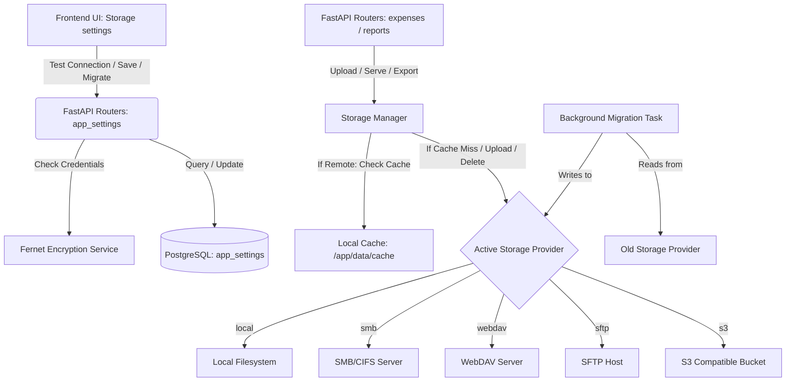

# Design Specification: Configurable Multi-Protocol Storage Location for Receipts & Reports

**Date**: 2026-06-12  
**Feature**: Configurable Storage Location (Local, SMB, WebDAV, SFTP, S3)  
**Role Scope**: Moderator (`mod`)  
**Branch**: `feature/configurable-storage`

---

## 1. Executive Summary & Objectives

The goal of this feature is to allow system Administrators/Moderators to dynamically configure where the application stores receipt files (e.g., uploaded JPG, PNG, PDF, WEBP images) and exported expense reports. Currently, storage is locked to the local container filesystem. We will extend this to support popular remote storage protocols:
* **Local / Mounted NAS Path**
* **SMB / CIFS** (Windows Share, Synology NAS direct)
* **WebDAV** (Synology WebDAV direct)
* **SFTP** (Secure Shell FTP)
* **S3 Compatible** (MinIO, AWS S3, Cloudflare R2, Synology C2)

Everything will be fully manageable from a frontend admin page, complete with a **"Test Connection"** verification tool and an **automatic background migration** assistant to move existing files to the new storage backend with zero system downtime.

---

## 2. Architecture & Data Flow



### 2.1 The Local Cache Solution (Approach 1)
To prevent performance bottlenecks and avoid rewriting the legacy report generation (`pdf_export.py` using ReportLab and `pypdf`) or file serving (`FileResponse` in `expenses.py`), we use a local cache folder: `/app/data/cache`.
* **File Serves**: The router calls `await get_local_path(relative_path)`. If the file is not in the cache, it is fetched from the active remote provider, written to the local cache, and served via `FileResponse`.
* **PDF Report Generation**: `generate_report_pdf` will resolve and cache all report receipt files in the async router *before* spawning the CPU-bound worker thread. The worker thread then reads directly from the cache.

---

## 3. Configuration Schema

We will store the storage settings in the `app_settings` table under the key `storage_config`.

```json
{
  "provider_type": "local", 
  "local": {
    "path": "/app/data/receipts"
  },
  "smb": {
    "host": "",
    "share": "",
    "username": "",
    "password": "", 
    "domain": "",
    "folder": "receipts"
  },
  "webdav": {
    "url": "",
    "username": "",
    "password": "",
    "folder": "receipts"
  },
  "sftp": {
    "host": "",
    "port": 22,
    "username": "",
    "password": "",
    "folder": "receipts"
  },
  "s3": {
    "endpoint_url": "",
    "access_key": "",
    "secret_key": "",
    "bucket_name": "",
    "region_name": ""
  }
}
```

* **Security**: All sensitive parameters (`password`, `secret_key`, etc.) will be encrypted on save and decrypted on load using `cryptography.fernet` using a static key or derived application secret.

---

## 4. Backend Implementation Specs

### 4.1 Base Storage Provider Interface
Located in `backend/xpenses/services/storage/base.py`:

```python
from abc import ABC, abstractmethod

class BaseStorageProvider(ABC):
    @abstractmethod
    async def upload_file(self, relative_path: str, content: bytes) -> None:
        """Write bytes to the storage location."""
        pass

    @abstractmethod
    async def download_file(self, relative_path: str) -> bytes:
        """Retrieve bytes from the storage location."""
        pass

    @abstractmethod
    async def delete_file(self, relative_path: str) -> None:
        """Delete file at the target storage location."""
        pass

    @abstractmethod
    async def file_exists(self, relative_path: str) -> bool:
        """Return True if the file exists on the storage destination."""
        pass

    @abstractmethod
    async def test_connection(self) -> tuple[bool, str]:
        """Establish a connection, write a temporary file, verify, delete, and return results."""
        pass
```

### 4.2 Libraries & Implementation Details
* **`LocalStorageProvider`**: Uses standard `pathlib` and `aiofiles`.
* **`S3StorageProvider`**: Uses **`boto3`** / **`botocore`**.
* **`SMBStorageProvider`**: Uses **`smbprotocol`**.
* **`SFTPStorageProvider`**: Uses **`paramiko`**.
* **`WebDAVStorageProvider`**: Custom lightweight WebDAV adapter built using async **`httpx`** calls (`GET`, `PUT`, `DELETE`, `PROPFIND`).

### 4.3 Storage Manager & Local Cache Coordinator
Located in `backend/xpenses/services/storage/manager.py`:
* Loads configuration from database.
* Instantiates active provider.
* Exposes `async def get_local_path(relative_path: str, db) -> str`.
* Handles cache lookup, remote fetch, and path resolution.

---

## 5. API Endpoints (Moderator Only)

1. **`GET /api/settings/storage`**
   * Returns current active storage type and configurations (passwords masked as `••••••••`).
2. **`PATCH /api/settings/storage`**
   * Updates configuration. Accepts a `migrate_existing: bool` flag to trigger background file migration.
3. **`POST /api/settings/storage/test`**
   * Instantiates a temporary provider client and runs `test_connection()`. Returns `{"success": true}` or `{"success": false, "message": "error details"}`.
4. **`GET /api/settings/storage/migration-status`**
   * Returns current progress of background migration:
     ```json
     {
       "status": "idle | running | completed | failed",
       "total_files": 120,
       "migrated_files": 45,
       "failed_files": 0,
       "errors": []
     }
     ```

---

## 6. Frontend UI & User Experience

We will create a new page at `frontend/app/admin/storage/page.tsx`.

### 6.1 Layout Features
* **Selection Dropdown**: Selector for storage protocol type.
* **Conditional Forms**: Displays corresponding configuration input boxes.
* **Test Connection Action**: Invokes the connection test endpoint with visual success checkmarks or error details.
* **Confirmation Dialogue**: When saving changes, prompts the user to launch a background migration.
* **Live Progress Card**: Displays file counts, errors list, and progress bar using interval-based status polling.

---

## 7. Testing Plan

We will add a robust test suite in `backend/tests/test_storage_settings.py` covering:
1. **Encryption / Decryption**: Verification of sensitive storage field protection.
2. **Local Caching Flow**: Testing file uploads, cache miss downloads, and serving logic.
3. **API Authorization**: Ensuring only `mod` role can read/edit storage configurations.
4. **Mocked Provider Calls**: Mocking remote connectors (S3, SMB, SFTP, WebDAV) to verify parameter mapping and connection failure handling.
5. **Migration Worker Task**: Simulating file migration from a mocked source provider to a mocked target provider, including progress-status DB updates.
