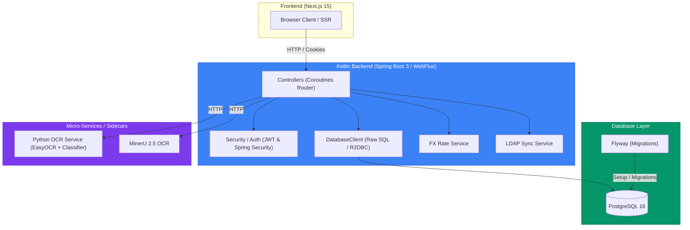

# Kotlin Backend Migration Plan — xpenses-kotlin

This document details the architectural design, technology stack, and step-by-step migration path for redoing the **xpenses** backend in **Kotlin**. 

---

## 1. Target Architecture & Tech Stack

To maintain the high-performance, asynchronous, lightweight, and "No ORM" nature of the existing FastAPI backend, the Kotlin backend will use a reactive, non-blocking stack with native coroutines.



### Stack Selection

| Component | Existing Python Stack | Proposed Kotlin Stack |
| :--- | :--- | :--- |
| **Runtime & Language** | Python 3.12 (CPython) | Java 21 / Kotlin 2.x |
| **Framework** | FastAPI (ASGI) | **Spring Boot 3.4 (Spring WebFlux + Kotlin Coroutines)** |
| **Concurrency Model**| `async`/`await` (AsyncIO) | **Kotlin Coroutines** (Lightweight threads) |
| **Database Driver** | `asyncpg` (Non-blocking) | **R2DBC (pg-r2dbc)** (Reactive Postgres driver) |
| **Database Access** | Raw SQL (No ORM) | **Spring `DatabaseClient`** (Reactive direct SQL mapping) |
| **Schema Migrations** | Alembic | **Flyway** (SQL-based migrations) |
| **Authentication** | Custom JWT + httpOnly cookies | **Spring Security Reactive** + Custom JWT filter |
| **PDF Generation** | ReportLab + PyPDF | **OpenPDF (iText fork)** or **PDFBox** |
| **LDAP Client** | `ldap3` (AsyncIO thread pool) | **Spring LDAP** or standard **JNDI** |
| **HTTP Client** | `httpx` (Async) | **Spring WebClient** (Reactive) |

---

## 2. Component Migration Strategy

### 2.1 Database Access (No ORM Pattern)
The Python codebase enforces a strict **No ORM** rule, executing raw SQL with positional placeholders (`$1`, `$2`). 
In Kotlin, we can match this pattern perfectly using Spring WebFlux's **`DatabaseClient`**. It allows executing raw SQL queries and mapping them to Kotlin data classes or maps asynchronously:

```kotlin
// Example Kotlin R2DBC query equivalent to asyncpg
suspend fun findExpenseById(id: Int): Expense? {
    return databaseClient.sql("SELECT * FROM expenses WHERE id = $1")
        .bind(0, id) // positional mapping
        .map { row, _ -> row.toExpense() }
        .awaitSingleOrNull()
}
```

### 2.2 Schema Migrations
We will replace **Alembic** with **Flyway**.
- Flyway SQL migration scripts will be placed in `src/main/resources/db/migration/`.
- We will carry over the exact SQL DDL from the Alembic migrations (`V1__init.sql`, `V2__add_raw_ocr_text.sql`, etc.).
- On startup, Flyway will run automatically, verifying the database schema and running new migrations. If the database is legacy (has tables but no `flyway_schema_history`), Flyway's `baselineOnMigrate=true` flag will stamp the schema.

### 2.3 Authentication & JWT
- **Spring Security Reactive** will protect endpoints.
- A custom `WebFilter` will intercept requests, extract `access_token` and `refresh_token` from cookies, validate them, and populate the Security Context.
- Role gates will be implemented using annotations: `@PreAuthorize("hasRole('mod')")`.

### 2.4 LDAP Service
- **Spring LDAP** provides template-based interactions with LDAP/AD directories.
- We will run sync operations asynchronously inside a coroutine:
  ```kotlin
  suspend fun syncLdapUsers() = withContext(Dispatchers.IO) {
      // execute LDAP sync transactionally
  }
  ```

### 2.5 OCR Scanning (EasyOCR & Classifier Sidecar)
EasyOCR and the Naive Bayes category classifier are Python-centric. Running Python libraries directly inside a JVM process via JNI (Jep/Jython) is unstable and slow.
- **Solution**: We will isolate the OCR and classifier logic into a lightweight **Python sidecar service** (`xpenses-ocr-sidecar`) exposing a single internal HTTP endpoint `/api/internal/scan`.
- The Kotlin backend will send the multipart file to this sidecar over the Docker internal network (`INTERNAL_OCR_URL=http://ocr-sidecar:5000`), maintaining full compatibility with the existing Python OCR logic.
- Gemini and MinerU connections can be called directly from the Kotlin backend using `WebClient`.

### 2.6 PDF Export & Receipt Merging
- **PDF Generation**: We will use the **OpenPDF** library to construct the Zoho-style corporate invoice PDFs. It provides exact coordinate table layouts, images, and text positioning.
- **PDF Merging**: **Apache PDFBox** will be used to merge receipt PDFs onto the end of the report document, replacing `pypdf`.

---

## 3. Step-by-Step Task Breakdown

### Phase 1: Project Bootstrapping
- [ ] Initialize Kotlin project using Spring Initializr (Gradle Kotlin DSL, Kotlin 2.x, Java 21).
- [ ] Configure `build.gradle.kts` dependencies:
  - Spring Boot WebFlux, R2DBC, PostgreSQL R2DBC, Spring Security, Spring LDAP.
  - JWT (io.jsonwebtoken:jjwt), OpenPDF, Apache PDFBox, Flyway Core.
  - Kotlin Coroutines Reactor, Jackson Kotlin module.
- [ ] Setup `application.yml` referencing environmental configuration matching `.env`.

### Phase 2: Schema Migrations & R2DBC Setup
- [ ] Export base SQL schemas to `V1__init.sql` and `V2__add_raw_ocr_text.sql`.
- [ ] Configure Flyway startup properties.
- [ ] Configure `DatabaseClient` connection pool (`ConnectionFactory`).

### Phase 3: Authentication & Security Filter
- [ ] Create encryption/decryption utilities using JVM Cryptography (AES/Fernet equivalent) to decrypt stored LDAP, SMTP, and IMAP passwords.
- [ ] Implement TokenProvider (generating 15-min access and 7-day refresh JWT tokens).
- [ ] Build Reactive Custom Authentication filter to read cookies.

### Phase 4: Core CRUD Routers Migration
- [ ] **Categories Controller**: Translate GET, POST, PUT, DELETE endpoints.
- [ ] **Expenses Controller**: Translate CRUD routes. Compute automatic FX conversions on save/update.
- [ ] **Reports Controller**: Translate report state transitions (`draft → submitted → approved → paid`) inside R2DBC database transaction scopes.

### Phase 5: Advanced Features Migration
- [ ] **Mileage Router**: Translate mileage calculations and CFO settings adjustments.
- [ ] **Advances Router**: Translate requested and paid advances workflows.
- [ ] **Digital Signatures**: Build image handler to write and retrieve base64 PNGs.
- [ ] **IMAP Daemon**: Implement a Spring `@Scheduled` background task monitoring active IMAP mailboxes for email forward ingestion.

### Phase 6: OCR & PDF Services
- [ ] Split off `ocr_service.py` and `classifier_service.py` from the Python backend into a slim `ocr-service/` subproject running a simple Flask or FastAPI app.
- [ ] Write Kotlin `OcrClient` using `WebClient` to communicate with the sidecar.
- [ ] Implement `PdfService` using OpenPDF to compile Zoho-styled invoice files.

### Phase 7: Dockerization & Testing
- [ ] Write Kotlin backend `Dockerfile` using multi-stage builds (`eclipse-temurin:21-jre-alpine`).
- [ ] Reconfigure `docker-compose.yml` services:
  - Change `backend` build folder to `./backend-kotlin`.
  - Add `ocr-sidecar` Python service.
- [ ] Write controllers unit/integration tests using JUnit 5, Mockk, and WebTestClient.

---

## 4. Initial Migration Setup Directory Structure

The repository directory layout for the Kotlin backend will be structured as follows:

```
xpenses-kotlin/
├── backend-kotlin/               # New Kotlin Backend Project
│   ├── src/
│   │   ├── main/
│   │   │   ├── kotlin/
│   │   │   │   └── eu/nt/xpenses/
│   │   │   │       ├── controllers/
│   │   │   │       ├── services/
│   │   │   │       ├── security/
│   │   │   │       ├── config/
│   │   │   │       └── db/
│   │   │   └── resources/
│   │   │       ├── db/migration/ # Flyway SQL migration scripts
│   │   │       └── application.yml
│   │   └── test/
│   ├── build.gradle.kts
│   └── settings.gradle.kts
├── backend/                      # Old Python Backend (to be migrated)
├── ocr-sidecar/                  # Python sidecar for EasyOCR & Classifier
│   ├── app.py
│   ├── requirements.txt
│   └── Dockerfile
├── frontend/                     # Next.js Frontend (unchanged)
└── docker-compose.yml            # Updated compose configuration
```
