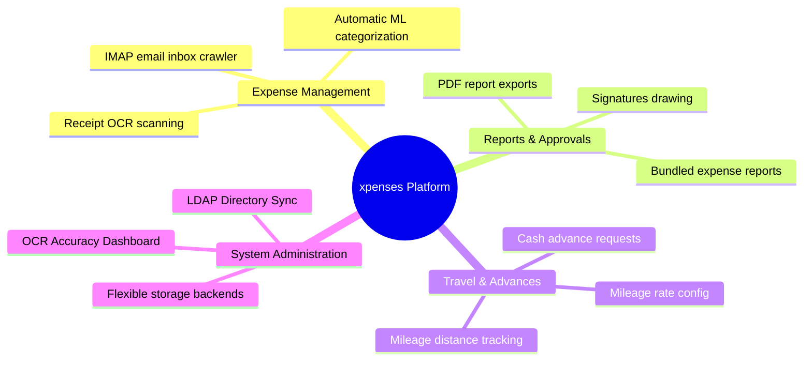

# xpenses — Corporate Expense Management Platform
### Comprehensive System Presentation & Workflow Transformation Report

---

## 1. Executive Summary & Value Proposition

**xpenses** is a secure, automated, and centralized enterprise platform designed to eliminate paper-based receipts, automate expense reporting, and streamline the approval/reimbursement cycle.

### Core Value Drivers:
* **80% Faster Processing**: Automated OCR scanning and AI classification eliminate manual typing.
* **100% Policy Compliance**: Structured multi-level approval workflows (User ➔ Moderator/Approver ➔ CFO/Payer).
* **Enterprise Infrastructure**: Integrated Active Directory (LDAP), multi-engine OCR, and plug-and-play cloud/on-premise storage adapters.
* **Cost Controls**: In-depth tracking of mileage rates, cash advances, and local comparison engines to minimize cloud API billing.

---

## 2. Core Modules & Functions



### 1. Automated Expense Ingestion & OCR
* **Instant Digitization**: Drag-and-drop receipt upload.
* **Tri-Engine OCR Setup**:
  * **Gemini OCR (Cloud)**: Top-tier, complex document parsing.
  * **MinerU 2.5 (Local)**: High-speed, private document and table parser.
  * **EasyOCR (Local)**: Compact local engine running in parallel to calculate baseline accuracies.
* **IMAP Mailbox Scanning**: Automatically scans a designated company inbox (e.g., `invoices@company.com`) to extract PDF and image receipt attachments directly into employee draft lists.

### 2. Comprehensive Reports & Approval Cycle
* **Bundled Reports**: Employees group related expenses, mileage logs, and advances into single reports.
* **Draw & Save Signatures**: Secure signature drawing pads for employee sign-offs directly inside their profile.
* **Structured Authorization Pipeline**:
  1. **Draft**: Employee drafts the report.
  2. **Submission**: Report is digitally signed and sent.
  3. **Verification**: Moderators inspect receipts and approve/reject.
  4. **Payment**: CFO processes the approved list for direct bank transfer.

### 3. Business Travel & Cash Advances
* **Mileage Log Tracking**: Employees record date, purpose, and distance traveled. The system automatically computes the reimbursement based on rates configured by the CFO.
* **Cash Advances**: Seamlessly request cash before a business trip, which automatically offsets the final report amount.

---

## 3. Technology Stack & Architecture

The system is built for extreme reliability, horizontal scaling, and quick offline/local deployability:

```
┌────────────────────────────────────────────────────────┐
│                   Next.js 15 Frontend                  │
│   (Turbopack, React Query, Responsive CSS, Zod Form)   │
└───────────────────────────┬────────────────────────────┘
                            │ (Secure HTTPS REST API)
┌───────────────────────────▼────────────────────────────┐
│                    FastAPI Backend                     │
│    (Python 3.12, AsyncPG, Uvicorn, Naive Bayes ML)     │
└──────────────┬────────────┬─────────────┬──────────────┘
               │            │             │
┌──────────────▼───┐ ┌──────▼──────┐ ┌────▼──────────────┐
│ PostgreSQL Db    │ │ OCR Models  │ │ Storage Adapters  │
│ (asyncpg pool,   │ │ (EasyOCR,   │ │ (Local, AWS S3,   │
│  app settings)   │ │  MinerU)    │ │  WebDAV, SFTP)    │
└──────────────────┘ └─────────────┘ └───────────────────┘
```

* **Frontend**: Next.js 15 client framework using React Query for smooth real-time screen transitions and Tailwind CSS for visual styling.
* **Backend**: FastAPI (Python 3.12) utilizing asynchronous database drivers (`asyncpg`) to handle high concurrent user traffic.
* **Storage Manager**: A modular storage wrapper allowing files to be migrated live from local storage to S3, SFTP, WebDAV, or SMB network shares.

---

## 4. Enterprise Security & Administration Controls

* **Active Directory / LDAP Sync**: Seamlessly sync company directory profiles, roles, and status (active/inactive) automatically.
* **Role-Based Access Control (RBAC)**:
  * **User**: Can upload receipts, log mileage, request advances, and submit reports.
  * **Moderator**: Can manage categories, review and approve/reject reports.
  * **CFO**: Can set mileage rates, manage global configurations, and mark reports as Paid.
* **Encrypted Secrets**: Sensitive API keys and connection credentials are encrypted using Fernet (AES-128) in CBC mode before storage.

---

## 5. Workflow Optimization & ROI Impact

### Time and Cost Comparison

| Operational Task | Before (Manual System) | Now (xpenses Platform) | Impact |
| :--- | :--- | :--- | :--- |
| **Receipt Logging** | 3 - 5 min (Manual typing) | **10 - 15 seconds** (OCR Auto-Fill) | **95% Time Saved** |
| **Category Coding** | Hard to enforce, frequent errors | **Automated suggestions** via local ML | **Standardized Accounting** |
| **Email Invoices** | Download, print, manually upload | **Zero effort** (Fetched from IMAP inbox) | **100% Automated Ingest** |
| **Manager Approvals**| Signed paper sheets, email tag | **One-click verification dashboard** | **Immediate Lifecycle Action** |
| **API Costs** | Ongoing monthly cloud API fees | **0$ fees** (Move to local MinerU/EasyOCR) | **Drastic cost reductions** |
